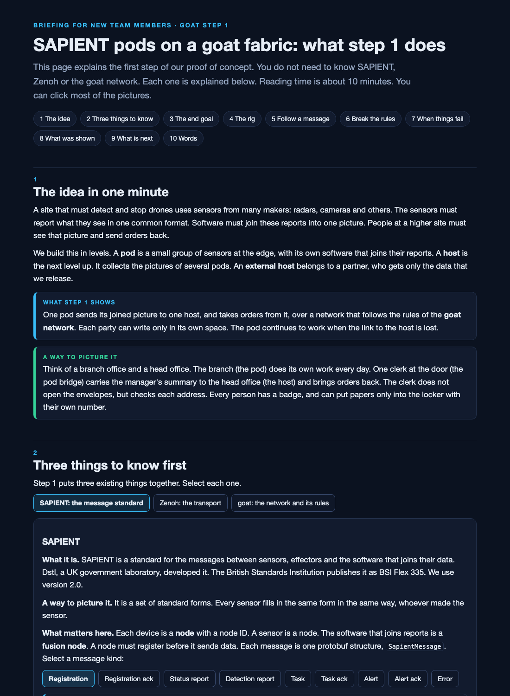

# The goat network work: SAPIENT pods on a goat fabric

This file is the entry page for the goat work in this repository. [`README.md`](README.md) covers the base rig (Apex in Docker and the fake nodes) and the four Zenoh stages that this work builds on.

**New to this work?** Start with the explainer page, [`docs/explainers/goat-step1/index.html`](docs/explainers/goat-step1/index.html). It explains SAPIENT, Zenoh and the goat network in plain words, then the end goal and step 1, and you can click through the rig and the message flows. Open the file in a browser from your clone, for example with `open docs/explainers/goat-step1/index.html` on a Mac. A code hosting site shows only the source of an HTML file. The page is one file, loads nothing else and needs no network.

[](docs/explainers/goat-step1/index.html)

For more on goat itself, two background pages are in the same folder: [goat in plain language](docs/explainers/goatcore/overview.html) and [goatcore: the technical note](docs/explainers/goatcore/architecture.html). They are studies of goat's source from before step 1. [`docs/explainers/README.md`](docs/explainers/README.md) lists all the explainer pages.

goat is the open source network of United States Army Europe and Africa: a mesh, a Zenoh data fabric, identities and a CA. The goal of this work is a real goatnet with three parts: pod 1 at the edge, a host in a cloud or a data centre, and an external host that belongs to a different sovereign. The work has six steps.

| Step | Content | Status |
|---|---|---|
| 1 | Pod 1 to host, on a stand-in fabric that follows goat's rules | Done on 2026-11-12 (UTC). The section below has the drawings and the run steps. |
| 2 | Stone Soup in the fusion node | Not started |
| 3 | Billie adapter for a sensor with a vendor protocol | Not started |
| 4 | The host on a real goatnet (a goatlite) | Done on 2026-11-18 to 19 UTC against the goatlite `cuaslab`, on branch `goat-step4-cuaslab`. The section "Goat step 4" below has the run steps. |
| 4b | The host on its own machine: the host services of step 4 in a third VM | Done on 2026-11-19 UTC, on branch `goat-step4b-host-vm`, stacked on `goat-step4-cuaslab`. The section "Goat step 4b" below has the run steps. |
| 5 | Pod 2 | Not started |
| 6 | External host, the second sovereign | Not started |

## Documents

| File | Content |
|---|---|
| `docs/explainers/goat-step1/index.html` | An interactive page for a new team member: the background, the end goal, the rig of step 1 and its message flows |
| `docs/explainers/goat-step4/index.html` | An interactive page on step 4: goatlite and the goatnet `cuaslab`, the rig on it, what was tested and what was learned |
| `docs/explainers/goat-step4b/index.html` | An interactive page on step 4b: the host on its own VM, the three machines, a task hop by hop, the clocks, the link cuts, what was tested and what was left |
| `docs/explainers/goatcore/` | Two background pages on goat: one in plain language, one technical |
| `docs/goat-roadmap.md` | The six steps: what is decided, what is open, and how a step is started |
| `docs/goat-context.md` | The goat rules that this work follows, with a source for each rule |
| `docs/superpowers/specs/2026-11-11-goat-step1-pod-to-host-design.md` | The design of step 1 |
| `docs/superpowers/plans/2026-11-11-goat-step1-pod-to-host.md` | The plan of step 1 |
| `docs/acceptance-goat1.md` | The acceptance record of step 1: checks G1-01 to G1-11, the known limits, and the open items for step 4 |
| `docs/evidence/goat1/` | The saved outputs and logs that the record and this file quote, with an index and a quote checker |
| `docs/superpowers/specs/2026-11-18-goat-step4-cuaslab-design.md` | The design of step 4 |
| `docs/superpowers/plans/2026-11-18-goat-step4-cuaslab.md` | The plan of step 4 |
| `docs/acceptance-goat4.md` | The acceptance record of step 4: checks G4-01 to G4-13, what was not shown, and what stays on `cuaslab` |
| `docs/evidence/goat4/` | The saved outputs of step 4 that the record and this file quote, with an index and a quote checker that also searches for secrets |
| `docs/superpowers/specs/2026-11-19-goat-step4b-host-vm-design.md` | The design of step 4b |
| `docs/superpowers/plans/2026-11-19-goat-step4b-host-vm.md` | The plan of step 4b |
| `docs/acceptance-goat4b.md` | The acceptance record of step 4b: checks G4B-01 to G4B-11, the known limits, and what step 4b left on the machines |
| `docs/evidence/goat4b/` | The saved outputs of step 4b that the record and this file quote, with an index and a quote checker that also searches for secrets |

## Before you start

Build the image `apex-sapient:4.2.0` and start Colima as sections 1 to 3 of [`README.md`](README.md) describe. Step 10 below also needs the goat source in `../usareur-af/goatcore` and a network connection.

## Goat step 1: pod 1 to host

This step carries pod 1's SAPIENT traffic to a host over a fabric that follows the goat network's rules. `docker-compose.goat1.yml` runs two routers and the nodes around them:

- **Pod 1** (network `pod1`): the pod router `zenohd-pod` (`eclipse/zenoh:1.10.2`, `zenoh/goat1/router-pod1.json5`), the fusion node, radar, camera, the vehicle behind `bridge-node`, and the pod recorder. Pod keys are prefixed `h1/p1/`. Each sensor holds a slot certificate whose common name is its node ID.
- **The pod bridge** (networks `pod1` and `mesh`): `pod_bridge.py` holds the pod's bridge certificate on the pod router and the pod's slot certificate on the fabric router, and forwards the bytes unchanged in both directions. Only the fusion node's traffic goes up.
- **The host** (network `host`): the fabric router `zenohd-fabric` (`${FABRIC_ZENOH_IMAGE:-eclipse/zenoh:1.9.0}`, `zenoh/goat1/router-fabric.json5`), a fusion node with `TRANSPORT=fabric`, and a recorder with `RECORD_KEYS=fabric`. Fabric keys start with the writer's 32-character anchor, and the fabric router lets each certificate write only below its own anchor.

`radar2` sits behind the compose profile `join`: the rig starts without `radar2` unless the profile `join` is named, as step 9 does. The generator writes the router configurations, the certificates and `zenoh/goat1/goat1.env` below `zenoh/goat1/`, which is git-ignored. The compose file is standalone: don't combine it with the other compose files. It uses the project name `apex-goat1` and the image `apex-sapient:4.2.0` built by the earlier stages. No router port is published to the host.

### The rig of step 1

One Docker Compose project, `apex-goat1`, on one machine. Three Docker networks take the place of the pod's local network, the mesh and the host's network.

```
 network pod1: pod 1, site p1                          network host: the host, site h1
+------------------------------------------------+    +----------------------------------------+
|                                                |    |                                        |
|  radar   (slot 0) ----+                        |    |  host-fusion          host-recorder    |
|  camera  (slot 1) ----+                        |    |  (slot 1)             (slot 2)         |
|  fusion-node ---------+--TLS-->  zenohd-pod    |    |       |                    |           |
|  recorder ------------+          Zenoh 1.10.2  |    |       +------- TLS --------+           |
|  bridge-node (slot 2)-+          pod CA        |    |                 |                      |
|       ^                          8 slots       |    |                 v                      |
|       | TCP, no TLS                 ^          |    |           zenohd-fabric                |
|  vehicle (legacy node)              | TLS      |    |           Zenoh 1.9.0                  |
|                                     |          |    |           fabric CA, 8 slots           |
|  radar2 (slot 3) joins         pod-bridge      |    |                 ^                      |
|  later, in step 9              (named cert)    |    |                 | TLS                  |
+-------------------------------------|----------+    +-----------------|----------------------+
                                      |                                 |
                                      +---------------------------------+
                                          network mesh: TLS, the bridge uses fabric slot 0
                                          (in place of the WireGuard mesh of a real goatnet)
```

- **Two CAs.** The pod CA signs everything inside the pod. The fabric CA signs the host side and the bridge's slot certificate.
- **The pod bridge** is the only part on both sides. It has a named pod certificate for `zenohd-pod` and the certificate of fabric slot 0 for `zenohd-fabric`. It copies the bytes unchanged.
- **Slots.** In the pod, a slot gives a sensor its certificate and its node ID. On the fabric, a slot gives a client its certificate and its anchor, the first part of every key that it may write. Fabric slot 3 is the `goat` test client of step 10.
- **Named pod identities**, not in the pool: the pod router, `fusion-node`, `recorder` and `pod-bridge`.

### The data flow of step 1

```
UP: registration, status, tracks, alerts, task acknowledgements

 sensor        pod fusion node       pod bridge         fabric router        host fusion
 (pod 1)                                                                   + host recorder
    |                 |                   |                   |                   |
    |------ (1) ----->|                   |                   |                   |
    |                 |------- (2) ------>|                   |                   |
    |                 |                   |------- (3) ------>|                   |
    |                 |                   |                   |------- (3) ------>|

DOWN: tasks and acknowledgements from the host

 sensor        pod fusion node       pod bridge         fabric router        host fusion
 (pod 1)                                                                   + host recorder
    |                 |                   |                   |                   |
    |                 |                   |                   |<------ (4) -------|
    |                 |                   |<------ (4) -------|                   |
    |                 |<------ (5) -------|                   |                   |
    |<----- (6) ------|                   |                   |                   |
```

| Hop | Key | Who may write it |
|---|---|---|
| (1) | `h1/p1/sapient/v2/<sensor ID>/up/<kind>` | that sensor's slot only |
| (2) | `h1/p1/fusion/up/<kind>` | the pod fusion node |
| (3) | `<pod anchor>/telemetry/sapient/p1/v2/<kind>/<fusion node ID>`, and `<pod anchor>/ack/p1/sapient/v2/task_ack/<fusion node ID>` for a task acknowledgement | fabric slot 0, the pod bridge |
| (4) | `<host anchor>/task/p1/sapient/v2/task/<fusion node ID>`, and `<host anchor>/ack/p1/sapient/v2/<kind>/<fusion node ID>` for an acknowledgement | fabric slot 1, the host fusion node |
| (5) | `h1/p1/fusion/down/<kind>` | the pod bridge |
| (6) | `h1/p1/sapient/v2/<sensor ID>/down/task` | the pod fusion node |

- **Raw sensor data stops at the pod fusion node.** Only what the fusion node sends on (2) reaches the fabric: its registration, its status, its fused tracks and its alerts.
- **The host tasks only the pod fusion node.** At (6) the fusion node sends a copy of the command, with a new task ID, to each registered sensor that the command is meant for.
- **Presence.** While the pod fusion node sends traffic, the bridge holds a liveliness token on `<pod anchor>/telemetry/sapient/p1/v2/live/<fusion node ID>`. The host removes the node when the token has been away for the hold time.
- **Checks on the way down, at the bridge.** It drops a message that does not decode, whose destination is not the node in the key, that is for a node it has not forwarded upward, or that is a task older than 5 seconds. The pod fusion node then validates what arrives; its validator also rejects a message whose timestamp is more than 0.9 s behind its clock.

The values in this rig: the pod anchor is `18214b1a34e3c722d1cac283b272a62c` (fabric slot 0), the host anchor is `b005ae3a8f2baf89160bd71632902672` (fabric slot 1), and the pod fusion node's ID is `f0000001-0000-4000-8000-000000000001`.

### Run it

Run these in order, from the repo root, on a rig that is down. Below each block is what one run printed on 2026-11-12 UTC, with the code of commit `c6a2db1` and the commands of this section as written now (steps 3 and 5 were changed just before the run and committed after it): steps 1 to 10 pasted in order into one zsh, with no generated files below `zenoh/goat1/` and no `apex-goat1-cargo-target` volume at the start. The blocks are shortened: `dg` also prints container lines (`Creating`, `Recreate`, `Started` and the like), the probe prints a `connected to Zenoh router` line, and `sub` prints up to four `e.g.` lines with sample keys; all of these are left out here. The saved output of the run is `docs/evidence/goat1/task-12-readme-run.txt`. After the fixes of the final review, a run of the same steps at commit `e02a289` gave the same results in substance, with other times, IDs and record counts; its output is `docs/evidence/goat1/final-fix-readme-run.txt`, and `docs/acceptance-goat1.md` records it in the section "Run after the review fixes".

```bash
dg() { docker compose --env-file zenoh/goat1/goat1.env -f docker-compose.goat1.yml "$@"; }
probe() { local service=$1; shift; dg run --rm --no-deps -T "$service" python probe_access.py "$@" < /dev/null; }
podfabric() { dg run --rm --no-deps -T -e ZENOH_CONNECT=tls/router.fabric.h1:7447 -e ZENOH_TLS_CA=/certs/fabric/ca.pem -e ZENOH_TLS_CERT=/certs/fabric/pod1.pem -e ZENOH_TLS_KEY=/certs/fabric/pod1.key pod-bridge python probe_access.py "$@" < /dev/null; }
```

`probe` runs `emulators/probe_access.py` in a one-off container of a service, with that service's certificate: `put <key>` publishes one status report, and `sub <key expression> <seconds>` counts what arrives and how much of it came from the probe. `podfabric` does the same with the pod's slot certificate on the fabric router. The `< /dev/null` keeps a one-off container from reading the rest of a pasted block.

**1. Generate and start.** Running the generator again is safe; it rewrites the same files.

```bash
python3 emulators/goatgen.py goat1/registry.toml zenoh/goat1
source zenoh/goat1/goat1.env
dg up -d
sleep 45
dg ps --format '{{.Service}} {{.State}}' | sort
dg logs zenohd-pod zenohd-fabric | grep -ci -E 'error|panic'
```

The 11 services were `running` (`bridge-node`, `camera`, `fusion-node`, `host-fusion`, `host-recorder`, `pod-bridge`, `radar`, `recorder`, `vehicle`, `zenohd-fabric`, `zenohd-pod`), and the error count was `0`.

**2. Registration (G1-03).** The pod's fusion node accepts its three sensors, then registers upward and gets the host's acknowledgement.

```bash
dg logs fusion-node | grep registration_ack
dg logs host-fusion | grep "<- registration "
```

```text
fusion-node-1  | 01:23:42 fusion: -> registration_ack f0000001 -> 86ca6000 acceptance=True ['Accepted by fake fusion node']
fusion-node-1  | 01:23:42 fusion: -> registration_ack f0000001 -> 1aef1b86 acceptance=True ['Accepted by fake fusion node']
fusion-node-1  | 01:23:42 fusion: -> registration_ack f0000001 -> 341b9172 acceptance=True ['Accepted by fake fusion node']
fusion-node-1  | 01:23:47 fusion: <- registration_ack f0000002 -> f0000001 acceptance=True ['Accepted by fake fusion node']
host-fusion-1  | 01:23:47 fusion: <- registration f0000001 "fake fusion node" [FUSION_NODE]
```

**3. Tracks and alerts up (G1-02).** The host gets the pod's fused tracks and one alert for each new track. The host recorder holds only messages below the pod's anchor or the host fusion node's anchor, and none of them carries a sensor's node ID.

```bash
dg logs host-fusion | grep -c "<- detection_report"
dg logs host-fusion | grep "<- alert"
dg exec -T host-recorder sh -c 'cat /data/records/*.jsonl' < /dev/null | python3 -c '
import collections, json, sys
anchors, sensors = set(sys.argv[1:3]), set(sys.argv[3:6])
rows = [json.loads(line) for line in sys.stdin if line.strip()]
print("records:", len(rows))
print("anchor not the pod or the host fusion node:", sum(r.get("anchor") not in anchors for r in rows))
print("msg.node_id of the radar, camera or vehicle:", sum(r.get("msg", {}).get("node_id") in sensors for r in rows))
def paths(x, at):
    if isinstance(x, dict):
        for k, v in x.items():
            yield from paths(v, at + "." + k)
    elif isinstance(x, list):
        for v in x:
            yield from paths(v, at + "[]")
    elif isinstance(x, str) and any(s in x for s in sensors):
        yield at
print("records that did not decode:", sum("error" in r for r in rows))
print("records with a sensor node ID anywhere:", sum(any(True for _ in paths(r, "")) for r in rows))
hits = collections.Counter((r.get("kind"), at) for r in rows for at in paths(r, ""))
for (kind, at), n in sorted(hits.items()):
    print(" ", kind, at, n)
' "$FABRIC_POD1_ID" "$FABRIC_HOST_FUSION_ID" "$POD1_RADAR_ID" "$POD1_CAMERA_ID" "$POD1_VEHICLE_ID"
```

```text
5
host-fusion-1  | 01:23:47 fusion: <- alert f0000001 ALERT_TYPE_INFORMATION "new track Z6EWXY"
records: 4656
anchor not the pod or the host fusion node: 0
msg.node_id of the radar, camera or vehicle: 0
records that did not decode: 0
records with a sensor node ID anywhere: 0
```

The detection count is low because the fusion node logs every 10th detection report of each node. The recorder's volume survives `dg down`, so the record count includes any earlier run on the same UTC day. The last three lines search each whole record, not only its top-level `node_id`: a record that did not decode would hold only base64, so it is counted apart; the next line counts the records that hold the node ID of the radar, the camera or the vehicle in any string field; below it each such field would be listed with its message kind. Here there were none.

**4. A task down (G1-04).** The host's fusion node sends `request:Status` and `look_at` in turn, every 20 s. The pod's fusion node passes `look_at` to its registered sensors as a copy with a new task ID, and acknowledges upward.

```bash
dg logs radar camera | grep "<- task .* look_at" | cut -c1-90
dg logs host-fusion | grep "<- task_ack" | grep TASK_STATUS_ACCEPTED
```

```text
camera-1  | 01:24:22 camera: <- task f0000001 -> 86ca6000 ETGGDQ look_at {"location_list":
radar-1   | 01:24:22 radar: <- task f0000001 -> 1aef1b86 CGEN0T look_at {"location_list":
host-fusion-1  | 01:24:02 fusion: <- task_ack f0000001 -> f0000002 9NZKWJ TASK_STATUS_ACCEPTED ['Status report sent']
host-fusion-1  | 01:24:22 fusion: <- task_ack f0000001 -> f0000002 C6A1J0 TASK_STATUS_ACCEPTED ['look_at sent to 2 nodes']
```

**5. Access on the live routers (G1-05).** Restart both routers with the access-control trace. A denial is silent for the client, so each case shows two things: the subscriber, whose certificate may read the key, got nothing from the probe, and the router logged the denial. On the fabric router each certificate matches two subjects (any mutual-TLS peer, and its own slot). The router tries each subject in turn and logs `unauthorized` for each one that denies, and stops at the first that allows with one `authorized` line (function `action` in `zenoh/src/net/routing/interceptor/access_control.rs`, Zenoh 1.9.0 and 1.10.2). So one denied put logs two `unauthorized` lines and no `authorized` line, while an allowed put can also log an `unauthorized` line before its `authorized` line. The test is therefore: no `authorized` line and 0 probe samples. Each count reads only the router's log since `T`, the second just before the probe started, so a line from before the probe is not counted.

```bash
ZENOHD_RUST_LOG=zenoh::net::routing::interceptor=trace dg up -d zenohd-pod zenohd-fabric
sleep 20
dg logs --since 30s pod-bridge
```

```text
pod-bridge-1  | 01:24:38 pod-bridge: pod router lost
pod-bridge-1  | 01:24:38 pod-bridge: fabric router lost
pod-bridge-1  | 01:24:39 pod-bridge: fabric router back
pod-bridge-1  | 01:24:39 pod-bridge: pod router back
pod-bridge-1  | 01:24:42 pod-bridge: forwarded {'up': 67, 'down': 5}; dropped {}
```

Case 1: the pod's slot certificate puts on the host fusion node's task key.

```bash
K="$FABRIC_HOST_FUSION_ID/task/p1/sapient/v2/task/$POD1_FUSION_NODE_ID"
T=$(date +%s)
probe host-recorder sub "$K" 15 &
sleep 5
podfabric put "$K"
wait
dg logs --since "$T" zenohd-fabric | grep -F "$K" | grep -F "CertCommonName($FABRIC_POD1_ID)" | grep -c "is unauthorized to Put (ingress)"
dg logs --since "$T" zenohd-fabric | grep -F "$K" | grep -F "CertCommonName($FABRIC_POD1_ID)" | grep -c "is authorized to Put (ingress)"
```

```text
put: 1 status report on b005ae3a8f2baf89160bd71632902672/task/p1/sapient/v2/task/f0000001-0000-4000-8000-000000000001
samples: 1 on b005ae3a8f2baf89160bd71632902672/task/p1/sapient/v2/task/f0000001-0000-4000-8000-000000000001 in 15 s; from this probe: 0
2
0
```

The one sample is the host's own periodic task on that key; none came from the probe.

Case 2: the host fusion certificate puts on the pod's alert key.

```bash
K="$FABRIC_POD1_ID/telemetry/sapient/p1/v2/alert/$POD1_FUSION_NODE_ID"
T=$(date +%s)
probe host-recorder sub "$K" 15 &
sleep 5
probe host-fusion put "$K"
wait
dg logs --since "$T" zenohd-fabric | grep -F "$K" | grep -F "CertCommonName($FABRIC_HOST_FUSION_ID)" | grep -c "is unauthorized to Put (ingress)"
dg logs --since "$T" zenohd-fabric | grep -F "$K" | grep -F "CertCommonName($FABRIC_HOST_FUSION_ID)" | grep -c "is authorized to Put (ingress)"
```

```text
samples: 0 on 18214b1a34e3c722d1cac283b272a62c/telemetry/sapient/p1/v2/alert/f0000001-0000-4000-8000-000000000001 in 15 s; from this probe: 0
2
0
```

Case 3: the host recorder's certificate may not subscribe to everything, only to the fabric's telemetry.

```bash
T=$(date +%s)
probe host-recorder sub "**" 15
probe host-recorder sub "*/telemetry/sapient/*/v2/*/*" 15
dg logs --since "$T" zenohd-fabric | grep -F "CertCommonName($FABRIC_HOST_RECORDER_ID)" | grep -F "Declare Subscriber (ingress) on **" | grep -c unauthorized
```

```text
samples: 0 on ** in 15 s; from this probe: 0
samples: 33 on */telemetry/sapient/*/v2/*/* in 15 s; from this probe: 0
2
```

Case 4: in the pod, the radar's certificate puts on the camera's up key.

```bash
K="h1/p1/sapient/v2/$POD1_CAMERA_ID/up/status_report"
T=$(date +%s)
probe recorder sub "$K" 15 &
sleep 5
probe radar put "$K"
wait
dg logs --since "$T" zenohd-pod | grep -F "$K" | grep -F "CertCommonName($POD1_RADAR_ID)" | grep -c "is unauthorized to Put (ingress)"
dg logs --since "$T" zenohd-pod | grep -F "$K" | grep -F "CertCommonName($POD1_RADAR_ID)" | grep -c "is authorized to Put (ingress)"
```

```text
samples: 3 on h1/p1/sapient/v2/86ca6000-1c36-4aed-875f-ac18ec0b5ab2/up/status_report in 15 s; from this probe: 0
1
0
```

The three samples are the camera's own status reports. The pod router has one subject for each certificate, so one line.

Put the routers back to `info`:

```bash
dg up -d zenohd-pod zenohd-fabric
```

**6. Host restart.** The restarted host fusion node asks the pod to register again, and acknowledges it.

```bash
dg restart host-fusion
sleep 40
dg logs --since 40s fusion-node | grep -E 'request "Registration"|registration_ack'
```

```text
fusion-node-1  | 01:26:37 fusion: <- task f0000002 -> f0000001 Q39T3Z request "Registration"
fusion-node-1  | 01:26:37 fusion: <- registration_ack f0000002 -> f0000001 acceptance=True ['Accepted by fake fusion node']
```

**7. Short outage (G1-06).** Cut the pod bridge off the `mesh` network for 30 s, less than the host's hold time of 120 s. The pod's sensors and fusion node log no loss, and the pod's fusion node still takes the sensors' detections. After the link returns, tracks reach the host again with no new registration. The bridge counts what the pod sent meanwhile as `other_side_down`.

```bash
docker network disconnect apex-goat1_mesh apex-goat1-pod-bridge-1
sleep 30
dg logs --since 30s radar camera vehicle fusion-node | grep -c -E 'lost|cannot reach'
dg logs --since 30s fusion-node | grep -c "<- detection_report"
docker network connect apex-goat1_mesh apex-goat1-pod-bridge-1
sleep 30
dg logs --since 25s host-fusion | grep -c "<- detection_report"
dg logs --since 60s host-fusion | grep -c "<- registration "
dg logs --since 70s pod-bridge
```

```text
0
6
2
0
pod-bridge-1  | 01:27:12 pod-bridge: forwarded {'up': 242, 'down': 13}; dropped {}
pod-bridge-1  | 01:27:27 pod-bridge: fabric router lost
pod-bridge-1  | 01:27:42 pod-bridge: forwarded {'up': 259, 'down': 14}; dropped {'other_side_down': 17}
pod-bridge-1  | 01:27:50 pod-bridge: fabric router back
pod-bridge-1  | 01:28:12 pod-bridge: forwarded {'up': 285, 'down': 15}; dropped {'other_side_down': 25}
```

The bridge notices the loss only when its session to the fabric router times out: in two timed runs of Task 10 it logged `fabric router lost` 9 to 10 s after the disconnect, and `fabric router back` 0 to 2 s after the connect. In the run above the step started at 01:27:17 and the loss was logged at 01:27:27. What it publishes before it notices counts as forwarded; these steps don't show whether it arrived.

**8. Long outage (G1-07).** Restart the rig with a host hold time of 20 s, then cut the bridge off for 40 s. The host removes the pod's fusion node, and when the link returns it asks for a registration, which the pod sends and the host accepts. The rig keeps the 20 s hold until the next `dg up` without `HOST_HOLD_SECONDS`.

```bash
dg down
HOST_HOLD_SECONDS=20 dg up -d
sleep 60
docker network disconnect apex-goat1_mesh apex-goat1-pod-bridge-1
sleep 40
docker network connect apex-goat1_mesh apex-goat1-pod-bridge-1
sleep 40
dg logs host-fusion | grep -E 'removed|request "Registration"|<- registration '
dg logs fusion-node | grep "<- registration_ack f0000002"
```

```text
host-fusion-1  | 01:28:53 fusion: <- registration f0000001 "fake fusion node" [FUSION_NODE]
host-fusion-1  | 01:30:18 fusion: node f0000001 gone for 20 s; removed
host-fusion-1  | 01:30:33 fusion: -> task f0000002 -> f0000001 R5NRPQ request "Registration"
host-fusion-1  | 01:30:33 fusion: <- registration f0000001 "fake fusion node" [FUSION_NODE]
fusion-node-1  | 01:28:53 fusion: <- registration_ack f0000002 -> f0000001 acceptance=True ['Accepted by fake fusion node']
fusion-node-1  | 01:30:33 fusion: <- registration_ack f0000002 -> f0000001 acceptance=True ['Accepted by fake fusion node']
```

The first registration is the one at start; the other lines follow the outage.

**9. A sensor joins with no router restart (G1-09).** The rig starts without `radar2` unless the profile `join` is named. Give `radar2` the free slot 3 of the pod's pool in the registry, and run the generator with `--frozen-routers`: it issues the new certificate and exits 0 only if neither router file changes. Then start `radar2`. The pod's fusion node accepts it, and the pod router keeps running.

```bash
before=$(docker inspect -f '{{.State.StartedAt}}' apex-goat1-zenohd-pod-1)
shasum -a 256 zenoh/goat1/router-pod1.json5 zenoh/goat1/router-fabric.json5
python3 -c 'import pathlib; p = pathlib.Path("goat1/registry.toml"); p.write_text(p.read_text().replace("[pod1.slots]\n", "[pod1.slots]\nradar2 = 3\n", 1))'
grep -A4 '^\[pod1.slots\]' goat1/registry.toml
python3 emulators/goatgen.py goat1/registry.toml zenoh/goat1 --frozen-routers
echo "exit $?"
shasum -a 256 zenoh/goat1/router-pod1.json5 zenoh/goat1/router-fabric.json5
source zenoh/goat1/goat1.env
dg --profile join up -d radar2
sleep 30
dg logs fusion-node | grep "<- registration " | grep -c "Fake second radar"
dg logs fusion-node | grep "registration_ack f0000001 -> ${POD1_RADAR2_ID:0:8}"
dg logs fusion-node | grep -c "<- detection_report ${POD1_RADAR2_ID:0:8}"
test "$before" = "$(docker inspect -f '{{.State.StartedAt}}' apex-goat1-zenohd-pod-1)" && echo "router not restarted"
dg logs zenohd-pod | grep -ci -E 'error|panic'
```

```text
c3a5e2b99a4a843d0322ddddd5dde61cf5c9796a25bb1d962af9c9b519b84627  zenoh/goat1/router-pod1.json5
f7f5e342377767ddcf0e22d754d22236f1417967dcd2891927b6aea54a3bedf8  zenoh/goat1/router-fabric.json5
[pod1.slots]
radar2 = 3
radar = 0
camera = 1
vehicle = 2
router files unchanged
exit 0
c3a5e2b99a4a843d0322ddddd5dde61cf5c9796a25bb1d962af9c9b519b84627  zenoh/goat1/router-pod1.json5
f7f5e342377767ddcf0e22d754d22236f1417967dcd2891927b6aea54a3bedf8  zenoh/goat1/router-fabric.json5
1
fusion-node-1  | 01:31:10 fusion: -> registration_ack f0000001 -> 83ff6077 acceptance=True ['Accepted by fake fusion node']
3
router not restarted
0
```

The detection count is low because the fusion node logs every 10th detection report of each node.

Take `radar2` out again and put the registry back as committed. The generator leaves the `radar2` certificate and key below `zenoh/goat1/pki/pod1/`, prints `router files unchanged` and exits 0; `goat1.env` no longer has `POD1_RADAR2_ID`.

```bash
dg --profile join rm -s -f radar2
git restore goat1/registry.toml
unset POD1_RADAR2_ID
python3 emulators/goatgen.py goat1/registry.toml zenoh/goat1 --frozen-routers
echo "exit $?"
git status --short goat1/registry.toml
```

```text
router files unchanged
exit 0
```

`git status` printed nothing: the registry is as committed.

**10. A real goat client reads the pod's tracks (G1-10).** This is the one check with goat's own software. Build goat's command line tool `goat` from the goat source in `../usareur-af/goatcore`, at commit `cbf2cb7f` (`goat-cli` 0.5.19), give it the certificate of fabric slot 3 (`FABRIC_GOAT_CLI_ID`), and let `goat sub` read below the pod's anchor from the fabric router.

The build runs in `rust:1.95.0-bookworm`, with the goat source mounted read-only, and needs the network for the image and for the crates. On an empty volume the build took 4 min 35 s by cargo's count, and the whole block 276 s, on a Colima VM with 4 CPUs and 6 GiB; a later build takes seconds. The build output and the downloaded crates stay in the Docker volume `apex-goat1-cargo-target`; remove it with `docker volume rm apex-goat1-cargo-target`. The binary goes to `zenoh/goat1/bin/goat` (git-ignored) and runs in `debian:bookworm-slim`.

```bash
docker run --rm -v "$PWD/../usareur-af/goatcore:/src:ro" -v apex-goat1-cargo-target:/target -e CARGO_TARGET_DIR=/target -e CARGO_HOME=/target/cargo-home rust:1.95.0-bookworm cargo build --release --locked -j 2 --manifest-path /src/crates/Cargo.toml -p goat-cli < /dev/null
mkdir -p zenoh/goat1/bin
docker run --rm -v apex-goat1-cargo-target:/target:ro -v "$PWD/zenoh/goat1/bin:/out" debian:bookworm-slim cp /target/release/goat /out/goat < /dev/null
docker run --rm -v "$PWD/zenoh/goat1/bin/goat:/usr/local/bin/goat:ro" debian:bookworm-slim goat --version < /dev/null
```

```text
    Finished `release` profile [optimized] target(s) in 4m 35s
goat 0.5.19
```

goat reads its profile from `GOAT_PROFILE_DIR`: `config.toml` names the context, and `contexts/goat1/` holds `profile.toml` (`router_endpoint`, `device_id`), `mtls.cert.pem`, `mtls.key.pem` and `ca-roots.pem`. Only the two `.toml` files are written below `zenoh/goat1/goat-profile/`. The `goat` helper mounts the slot 3 certificate, its key and the fabric CA read-only under the names goat expects, so the key is not copied. goat runs on the network `apex-goat1_host`, where the fabric router answers as `router.fabric.h1`.

```bash
mkdir -p zenoh/goat1/goat-profile/contexts/goat1
printf 'current_context = "goat1"\n' > zenoh/goat1/goat-profile/config.toml
printf 'router_endpoint = "tls/router.fabric.h1:7447"\ndevice_id = "goat-cli"\n' > zenoh/goat1/goat-profile/contexts/goat1/profile.toml
goat() { docker run --rm --network apex-goat1_host -e GOAT_PROFILE_DIR=/goat-profile -v "$PWD/zenoh/goat1/bin/goat:/usr/local/bin/goat:ro" -v "$PWD/zenoh/goat1/goat-profile/config.toml:/goat-profile/config.toml:ro" -v "$PWD/zenoh/goat1/goat-profile/contexts/goat1/profile.toml:/goat-profile/contexts/goat1/profile.toml:ro" -v "$PWD/zenoh/goat1/pki/fabric/goat-cli.pem:/goat-profile/contexts/goat1/mtls.cert.pem:ro" -v "$PWD/zenoh/goat1/pki/fabric/goat-cli.key:/goat-profile/contexts/goat1/mtls.key.pem:ro" -v "$PWD/zenoh/goat1/pki/fabric/ca.pem:/goat-profile/contexts/goat1/ca-roots.pem:ro" debian:bookworm-slim goat "$@" < /dev/null; }
```

Restart the fabric router with the access-control trace, as step 5 does, and subscribe. `--take` with `--for` makes `goat sub` exit non-zero if the samples don't arrive within 30 s. `--uuid` prints the whole anchor; without it goat shortens it to its first 8 characters. Then count, in the router's trace, slot 3's allowed subscriber declarations below the pod's anchor, the samples the router delivered to it, and its allowed writes of any kind.

```bash
source zenoh/goat1/goat1.env
ZENOHD_RUST_LOG=zenoh::net::routing::interceptor=trace dg up -d zenohd-fabric
sleep 20
goat --context goat1 sub "$FABRIC_POD1_ID/**" --take 1 --for 30s --uuid
echo "exit $?"
goat --context goat1 sub "$FABRIC_POD1_ID/telemetry/sapient/p1/v2/detection_report/*" --take 3 --for 30s --uuid --keys-only
echo "exit $?"
dg logs zenohd-fabric | grep -F "CertCommonName($FABRIC_GOAT_CLI_ID)" | grep -c "is authorized to Declare Subscriber (ingress) on $FABRIC_POD1_ID/"
dg logs zenohd-fabric | grep -F "CertCommonName($FABRIC_GOAT_CLI_ID)" | grep -c -E "is authorized to Put \(egress\) on $FABRIC_POD1_ID/telemetry/sapient/p1/v2/[a-z_]+/"
dg logs zenohd-fabric | grep -F "CertCommonName($FABRIC_GOAT_CLI_ID)" | grep -c -E "is authorized to (Put|Delete|Declare/Undeclare Liveliness Token) \(ingress\)"
dg up -d zenohd-fabric
```

```text
listening on `18214b1a34e3c722d1cac283b272a62c/**` via tls/router.fabric.h1:7447 — stopping after 1 event(s). Ctrl-C to stop.
18214b1a34e3c722d1cac283b272a62c/telemetry/sapient/p1/v2/detection_report/f0000001-0000-4000-8000-000000000001 hex:0a0c08bab0d4d706...
done after 0s — 1 event(s) on `18214b1a34e3c722d1cac283b272a62c/**` (the requested 1)
exit 0
listening on `18214b1a34e3c722d1cac283b272a62c/telemetry/sapient/p1/v2/detection_report/*` via tls/router.fabric.h1:7447 — stopping after 3 event(s). Ctrl-C to stop.
18214b1a34e3c722d1cac283b272a62c/telemetry/sapient/p1/v2/detection_report/f0000001-0000-4000-8000-000000000001
18214b1a34e3c722d1cac283b272a62c/telemetry/sapient/p1/v2/detection_report/f0000001-0000-4000-8000-000000000001
18214b1a34e3c722d1cac283b272a62c/telemetry/sapient/p1/v2/detection_report/f0000001-0000-4000-8000-000000000001
done after 2s — 3 event(s) on `18214b1a34e3c722d1cac283b272a62c/telemetry/sapient/p1/v2/detection_report/*` (the requested 3)
exit 0
2
4
0
```

The hex payload of the first sample is cut after its first bytes, marked `...`. The payload differs on each run.

Both runs exit 0, and every key starts with the pod's anchor `18214b1a34e3c722d1cac283b272a62c`. The three counts are measured: the router allowed two subscriber declarations, delivered four samples (the four that goat printed), and allowed no put, delete or liveliness token from slot 3. A count made afterwards on the saved router log of this run (`docs/evidence/goat1/task-12-g1-10-count.txt`), not by a command of this step, left no line from goat that is not a subscriber declaration, a delivery or a cache block, so it found no put, delete, query, liveliness token or liveliness query from goat at all. The router's other lines for slot 3 come in one burst for each session, all on one key expression: read from the trace, they are the decisions it works out for all nine actions when it caches a client's key expression (see step 5), not requests from goat. In the run above one subscriber declaration and one delivery also have an `unauthorized` line before their `authorized` line, from the first of the two subjects that slot 3 matches (see step 5). The last command puts the fabric router back to `info`.

To stop the step, run `dg down`. The recordings stay in the `apex-goat1_pod-records` and `apex-goat1_host-records` volumes. Don't add `-v` unless you mean to delete them. `docs/acceptance-goat1.md` records what passed and where each check falls short.

## Goat step 4: the step 1 rig on cuaslab

This step runs the rig of step 1 against a real goatnet, by configuration only. The goatnet is `cuaslab`, a goatlite that runs in a Lima VM (`goatlite`, Ubuntu 24.04, arm64, address `192.168.64.4`) on the same Mac as the rig. Its fabric router (`zenohd v1.9.0-modified`, image `ghcr.io/usareur-af/zenoh-pqc-fips`) takes the place of our stand-in `zenohd-fabric`, and its CA takes the place of the test fabric CA. The pod bridge, the host fusion node and the host recorder get slot identities from the `cuaslab` portal and connect to `tls/192.168.64.4:7447`. No program changes, and no existing file below `emulators/` changes.

- **The overlay.** `docker-compose.goat4.yml` is used on top of `docker-compose.goat1.yml`, with its own project name `apex-goat4`. It points the three fabric clients at the `cuaslab` router, mounts their files from `zenoh/goat4/pki/`, keeps `zenohd-fabric` from starting, and makes the pod's network `pod1` internal, so the pod bridge reaches the router only through `mesh`.
- **The helper.** `goat4/dg4.sh` defines `dg4` (the `dg` of step 1 with the overlay and both env files) and `goat4_ready`, which checks the seven files and `goat4.env` (each must be a regular file), that each anchor is the common name of its certificate, that no anchor is a step 1 ID, that no `FABRIC_*_ID` exported in the shell differs from `goat4.env`, that a container reaches the router (a Docker failure is reported apart), and that the step 1 rig is down. Use the overlay only through `dg4`: `docker-compose.goat4.yml` has no project name of its own, and without `-p apex-goat4` compose would take the project name of the step 1 file and reconfigure project `apex-goat1`.
- **The pod side** is that of step 1: the generator `goat1/registry.toml`, the pod CA and the pod router. The step 1 rig and this rig run one at a time.

All the checks of step 4 were run from 2026-11-18 to 19 UTC against `cuaslab` as it was then: stood up from goatcore `e44e893d`, with the portal setting `portal_bundle_create_bin` turned off (see the enrolment below). These task runs were made by scripts in the working directory of the plan, which are not kept. Below each block is what the task runs printed, from the evidence files in `docs/evidence/goat4/` (the file is named with each block). The blocks are shortened.

The commands were written out for zsh after the task runs. Several blocks were rebuilt from the task runs' outputs and working scripts, not copied from a command that ran:

- step 6: `fabprobe`, and the `dg4 stop` and `dg4 up -d` around the probes;
- step 7: the probe and the two counts of the pod part of G4-05;
- step 8: the pre-check of G4-06;
- step 9: the sleeps of G4-07;
- step 11: the commands of G4-09;
- step 12: the path `../goatlite-test/env.sh`;
- step 13: the clock script.

Then the whole section was run as written, in the form it had in commit `5784f38`, on 2026-11-19 UTC (the README run). It was one `zsh -f` script with stdin at `/dev/null`, not a paste into an interactive shell, so a paste was not tested. Its transcript is `docs/evidence/goat4/readme-run.txt`; the blocks there are numbered 1 to 18 in the order of this section. Of the 18 blocks, 17 ran and one, the enrolment, was not run. 15 printed output of the form shown here (counts, times and IDs differ from run to run), 2 printed output of another form (steps 6 and 8, see the notes there), and none failed. The text beneath a block says where the README run differed. One block was changed after the README run (step 8); the note there says so.

After a final review, the two start blocks (steps 2 and 9) were changed to start the rig only if `goat4_ready` passes, and README run 2 ran blocks 1 to 11 of this section again (the path checks through step 8, the enrolment not run), on 2026-11-19 UTC, with the new start of step 2 and the wait of step 8. Its transcript is `docs/evidence/goat4/readme-run-2.txt`; the blocks there have the same numbers. It also showed the gate: with `goat4.env` moved aside, the start line of step 2 printed `goat4_ready: missing file zenoh/goat4/goat4.env (or not a regular file)` and `exit=1`, and no container started. Steps 9 to 14 were not run again. `docs/acceptance-goat4.md` records what passed and where each check falls short.

### The rig of step 4

```
 Colima VM 192.168.64.5 (Docker, project apex-goat4)          Lima VM goatlite 192.168.64.4
+---------------------------------------------------+        +-----------------------------+
|  network pod1 (internal): pod 1 as in step 1       |        |  cuaslab, a goatlite        |
|  radar, camera, vehicle, fusion-node, recorder,    |        |                             |
|  zenohd-pod (pod CA)                               |        |  fabric router              |
|            |                                       |        |  zenohd v1.9.0-modified     |
|        pod-bridge -- network mesh --+              |        |  tls/0.0.0.0:7447           |
|        (slot of pod1-bridge)        |              |        |  cuaslab goatlite CA        |
|                                     |              |        |                             |
|  network host:                      |              |        |  portal (enrolment)         |
|  host-fusion   (slot of host-fusion)|              |        |                             |
|  host-recorder (slot of host-recorder)             |        |                             |
+-------------------------------------|-------------+        +--------------|--------------+
                                      |      TLS, no WireGuard              |
                                      +---- through the Mac 192.168.64.1 ---+
```

- The three fabric clients hold certificates that the `cuaslab` portal minted. The common name of each is its anchor.
- The path between the two VMs is a route on each VM through the Mac. It is not the goat mesh: the pod is not a mesh peer.
- `goat` on the Mac (check G4-10) reaches the same router with the founder's identity of the `cuaslab` context.

### Before you run it: the path to cuaslab

The rig reaches `192.168.64.4` only through two routes and the Mac's forwarding. They are not made by anything in this repository:

- Colima: `network.address: true`, and a provision step that adds a route to `192.168.64.4` via `192.168.64.1`, in `~/.colima/default/colima.yaml`.
- The goatlite VM: `/etc/netplan/91-colima-route.yaml`, a route to `192.168.64.5` via `192.168.64.1`.
- The Mac: `net.inet.ip.forwarding=1`.

If Colima gets another address or the Mac stops forwarding, the path is lost. These three commands show the state: the first should print the value 1, and the other two a route via `192.168.64.1`. They were not run in the task runs. The README run ran them (block 1 of `readme-run.txt`): the first printed `net.inet.ip.forwarding: 1`, and the other two a route via `192.168.64.1`.

```bash
sysctl net.inet.ip.forwarding
colima ssh -- ip route get 192.168.64.4
limactl shell goatlite -- ip route get 192.168.64.5
```

The check that the runs used is (d) of `goat4_ready` below: a container on the Colima VM opens a TCP connection to `192.168.64.4:7447` within 5 s.

An agent session that cannot read `~/.docker` sets `DOCKER_HOST=unix://$HOME/.colima/default/docker.sock` and a `DOCKER_CONFIG` of its own first, as in step 1.

### Enrolment: this writes to the goatnet

**This command writes to `cuaslab`.** It sets a grant for the custodian `richard@cuaslab.lan` (quota 5, affiliation `cuaslab-lab`) if there is none, and enrols three machines, each of which takes one slot of the pool. An enrolment is undone only by a revoke, which the script does not do. In step 4 it was run twice. The first run was refused (below). The second, after Richard's decision to change a portal setting, enrolled the three machines (`task-2-enrol-refused.txt`, `task-2-decision-and-portal-change.txt`, `task-2-enrol.txt`). The README run did not run it. It does not need to be run again: the three machines are enrolled. Run it again only if you mean to enrol on a goatnet with no such machines.

`goat4/enroll.sh` reads the operator key from the line `CUASLAB_PORTAL_OPERATOR_API_KEY=` of the secrets file that you name, and never prints or keeps it. It writes the certificates, the keys (mode 0600) and the root below `zenoh/goat4/pki/`, and the three anchors to `zenoh/goat4/goat4.env`; `zenoh/goat4/` is git-ignored. It keeps no API key and no bundle token. From its source, not run in step 4: a handle that the portal already holds is skipped if its files are present, and the script stops with nothing enrolled if they are missing. Added after the enrolment, and tested only against a fake portal: the script stops before any request if one of its target paths exists and is not a regular file (Docker makes a directory where a bind-mount source is missing), and if an enrolment request gets no answer it says that the portal's state is unknown; the next run then shows it, because a live handle without files stops the run.

```bash
goat4/enroll.sh ../goatlite-test/goatcore/.envrc.local.d/secrets.env
```

The first run on `cuaslab` was refused (`task-2-enrol-refused.txt`):

```text
enroll.sh: pod1-bridge: enrolment refused: HTTP 500, code mint
```

The portal could not mint the bundle: the lite preset sets `portal_bundle_create_bin` to `/usr/local/bin/bundle-create`, and on the box that path is an empty directory (`task-2-refusal-diagnosis.txt`). So a goatlite stood up at goatcore `e44e893d` enrols no machine until that setting is turned off or the binary is installed. Richard chose to turn it off in `cuaslab`'s group_vars and redeploy the portal with `goatbuilder` (`task-2-decision-and-portal-change.txt`). The second run printed (`task-2-enrol.txt`):

```text
pod1-bridge 7a640b349ac2e03848531fce2000fc57
host-fusion cd42939f9c6719ea485ed176909d6d64
host-recorder 1a91baed36cf317591d4f636751af357
wrote zenoh/goat4/goat4.env
```

### Run it

Run these in order, from the repo root, with the step 1 rig down.

**1. Version pairing (G4-01), before the rig starts.** `emulators/probe_fabric_pairing.py` opens two sessions to the `cuaslab` router: a writer with the certificate of `pod1-bridge`, which puts five payloads and declares a liveliness token below its anchor, and a reader with the certificate of `host-recorder`, which subscribes to that anchor and to liveliness on it.

```bash
source zenoh/goat4/goat4.env
docker run --rm -v $PWD/zenoh/goat4/pki:/pki:ro -v $PWD/emulators:/emulators:ro  -w /emulators -e ZENOH_CONNECT=tls/192.168.64.4:7447 -e ZENOH_TLS_CA=/pki/ca.pem -e ZENOH_TLS_CERT=/pki/pod1.pem -e ZENOH_TLS_KEY=/pki/pod1.key -e READER_TLS_CA=/pki/ca.pem -e READER_TLS_CERT=/pki/host-recorder.pem -e READER_TLS_KEY=/pki/host-recorder.key apex-sapient:4.2.0 python probe_fabric_pairing.py $FABRIC_POD1_ID
```

```text
session: writer true reader true
put below anchor received: 5 of 5
liveliness token seen by reader: true
```

`task-3-g4-01.txt`; exit 0. The same probe with port 7449, and with the step 1 pod CA for the reader, printed `false` and exited 1 (`task-3-g4-01-unreachable.txt`, `task-3-g4-01-reader-bad-ca.txt`).

**2. Generate and start.** The generator makes the pod side, as in step 1. Its fabric output (the stand-in router file and the test fabric certificates) is made and not used.

```bash
. goat4/dg4.sh
python3 emulators/goatgen.py goat1/registry.toml zenoh/goat1
source zenoh/goat1/goat1.env
source zenoh/goat4/goat4.env
goat4_ready && dg4 up -d
echo "exit=$?"
sleep 45
dg4 ps --format "{{.Service}} {{.State}}" | sort
dg4 logs zenohd-pod | grep -ci -E "error|panic"
```

```text
exit=0
bridge-node running
camera running
fusion-node running
host-fusion running
host-recorder running
pod-bridge running
radar running
recorder running
vehicle running
zenohd-pod running
0
```

`task-4-start.txt`. Ten services: `zenohd-fabric` does not start. The rig starts only if `goat4_ready` passes; `exit=0` then means that both the check and the start succeeded. The task run and the first README run had the older form `goat4_ready; echo "exit=$?"` and then `dg4 up -d`, which started the rig even after a failed check, and printed `exit=0` before compose's lines. The form above ran in README run 2 (block 4 of `readme-run-2.txt`), where `exit=0` came after compose's lines. `goat4.env` is sourced after `goat1.env`, so its three anchors replace the step 1 ones in the shell, as they do in `dg4`. The block's exit status is 1, because its last `grep -c` counts 0, which is the expected output (block 4 of `readme-run.txt`). In a shell with `set -e` the block would stop there.

**3. Registration (G4-03).**

```bash
dg4 logs fusion-node | grep registration_ack
dg4 logs host-fusion | grep "<- registration "
dg4 logs pod-bridge | grep "192.168.64.4"
```

```text
fusion-node-1  | 23:50:51 fusion: -> registration_ack f0000001 -> 86ca6000 acceptance=True ['Accepted by fake fusion node']
fusion-node-1  | 23:50:51 fusion: -> registration_ack f0000001 -> 341b9172 acceptance=True ['Accepted by fake fusion node']
fusion-node-1  | 23:50:54 fusion: -> registration_ack f0000001 -> 1aef1b86 acceptance=True ['Accepted by fake fusion node']
fusion-node-1  | 23:50:56 fusion: <- registration_ack f0000002 -> f0000001 acceptance=True ['Accepted by fake fusion node']
host-fusion-1  | 23:50:56 fusion: <- registration f0000001 "fake fusion node" [FUSION_NODE]
pod-bridge-1  | 23:50:51 pod-bridge: connected to Zenoh router at tls/192.168.64.4:7447
pod-bridge-1  | 23:50:51 pod-bridge: bridging tls/router.p1.h1:7447 and tls/192.168.64.4:7447 as 7a640b349ac2e03848531fce2000fc57 site p1
```

`task-4-g4-03.txt` (the run took the pod bridge's lines with `tail -15`).

**4. Tracks and alerts up (G4-02).** The recorder check is the script of step 3 of the step 1 section, with the anchors of `goat4.env`:

```bash
dg4 logs host-fusion | grep -c "<- detection_report"
dg4 logs host-fusion | grep "<- alert"
dg4 exec -T host-recorder sh -c 'cat /data/records/*.jsonl' < /dev/null | python3 -c '
import collections, json, sys
anchors, sensors = set(sys.argv[1:3]), set(sys.argv[3:6])
rows = [json.loads(line) for line in sys.stdin if line.strip()]
print("records:", len(rows))
print("anchor not the pod or the host fusion node:", sum(r.get("anchor") not in anchors for r in rows))
print("msg.node_id of the radar, camera or vehicle:", sum(r.get("msg", {}).get("node_id") in sensors for r in rows))
def paths(x, at):
    if isinstance(x, dict):
        for k, v in x.items():
            yield from paths(v, at + "." + k)
    elif isinstance(x, list):
        for v in x:
            yield from paths(v, at + "[]")
    elif isinstance(x, str) and any(s in x for s in sensors):
        yield at
print("records that did not decode:", sum("error" in r for r in rows))
print("records with a sensor node ID anywhere:", sum(any(True for _ in paths(r, "")) for r in rows))
hits = collections.Counter((r.get("kind"), at) for r in rows for at in paths(r, ""))
for (kind, at), n in sorted(hits.items()):
    print(" ", kind, at, n)
' "$FABRIC_POD1_ID" "$FABRIC_HOST_FUSION_ID" "$POD1_RADAR_ID" "$POD1_CAMERA_ID" "$POD1_VEHICLE_ID"
```

```text
9
host-fusion-1  | 23:50:56 fusion: <- alert f0000001 ALERT_TYPE_INFORMATION "new track DF0FB8"
records: 192
anchor not the pod or the host fusion node: 0
msg.node_id of the radar, camera or vehicle: 0
records that did not decode: 0
records with a sensor node ID anywhere: 0
```

`task-4-g4-02.txt`. The script that ran also printed the count of each anchor (`anchors seen`: 100 records below the pod's anchor and 92 below the host fusion node's); that line is not in the script above, and the exact text of the script that ran was not saved. With the project name `apex-goat4` the host recorder writes to the volume `apex-goat4_host-records`, not to the step 1 volume (from the compose files; the addendum of Task 6 found only step 1 anchors in the step 1 volume). Whether that volume held records of an earlier start was not recorded.

**5. A task down (G4-04).**

```bash
dg4 logs radar camera | grep "<- task .* look_at" | cut -c1-90
dg4 logs host-fusion | grep "<- task_ack" | grep TASK_STATUS_ACCEPTED
dg4 logs host-fusion | grep -ci -E "reject|stale|too old|timestamp"
```

```text
radar-1  | 23:51:31 radar: <- task f0000001 -> 1aef1b86 8S8H0W look_at {"location_list": {
camera-1  | 23:51:31 camera: <- task f0000001 -> 86ca6000 VSCMPX look_at {"location_list":
host-fusion-1  | 23:51:11 fusion: <- task_ack f0000001 -> f0000002 PGTVNM TASK_STATUS_ACCEPTED ['Status report sent']
host-fusion-1  | 23:51:31 fusion: <- task_ack f0000001 -> f0000002 CZ8V82 TASK_STATUS_ACCEPTED ['look_at sent to 2 nodes']
0
```

`task-4-g4-04.txt`. The last count looks for a message the host rejected for its time; there was none. As in step 2, the block's exit status is 1 because the last count is 0, the expected output (block 7 of `readme-run.txt`).

**6. Access on the fabric (G4-05, fabric part).** The `cuaslab` router logs no access decision, and we do not change its log level. So a refused write is shown by absence: a reader gets nothing below the foreign anchor, while a control write by the same certificate below its own anchor, in the same window, arrives. The rig's three fabric clients are stopped first, so no other traffic is below the two anchors. `fabprobe` runs `emulators/probe_access.py` in a one-off container with one of the three certificates of `zenoh/goat4/pki/`; the reader uses the certificate of `host-recorder`.

```bash
fabprobe() { local cert=$1; shift; docker run --rm --network bridge -v "$PWD/emulators:/emulators:ro" -v "$PWD/zenoh/goat4/pki:/pki:ro" -w /emulators -e ZENOH_CONNECT=tls/192.168.64.4:7447 -e ZENOH_TLS_CA=/pki/ca.pem -e ZENOH_TLS_CERT=/pki/$cert.pem -e ZENOH_TLS_KEY=/pki/$cert.key apex-sapient:4.2.0 python probe_access.py "$@" < /dev/null; }
P=a0000009-0000-4000-8000-000000000009
dg4 stop pod-bridge host-fusion host-recorder
fabprobe host-recorder sub "$FABRIC_HOST_FUSION_ID/**" 20 &
fabprobe host-recorder sub "$FABRIC_POD1_ID/**" 20 &
sleep 8
fabprobe pod1 put "$FABRIC_HOST_FUSION_ID/task/p1/sapient/v2/task/$POD1_FUSION_NODE_ID"
fabprobe pod1 put "$FABRIC_POD1_ID/telemetry/sapient/p1/v2/status_report/$P"
wait
fabprobe host-recorder sub "$FABRIC_POD1_ID/**" 20 &
fabprobe host-recorder sub "$FABRIC_HOST_FUSION_ID/**" 20 &
sleep 8
fabprobe host-fusion put "$FABRIC_POD1_ID/telemetry/sapient/p1/v2/alert/$POD1_FUSION_NODE_ID"
fabprobe host-fusion put "$FABRIC_HOST_FUSION_ID/task/p1/sapient/v2/task/$POD1_FUSION_NODE_ID"
wait
dg4 up -d
```

The run saved each probe's output apart; here they are in the order of the evidence file (`task-5-g4-05-fabric.txt`), without the probes' `connected` lines. Direction 1, the pod's slot certificate writes below the host fusion node's anchor:

```text
put: 1 status report on cd42939f9c6719ea485ed176909d6d64/task/p1/sapient/v2/task/f0000001-0000-4000-8000-000000000001
put: 1 status report on 7a640b349ac2e03848531fce2000fc57/telemetry/sapient/p1/v2/status_report/a0000009-0000-4000-8000-000000000009
samples: 0 on cd42939f9c6719ea485ed176909d6d64/** in 20 s; from this probe: 0
samples: 1 on 7a640b349ac2e03848531fce2000fc57/** in 20 s; from this probe: 1
```

Direction 2, the host fusion node's certificate writes below the pod's anchor (`task-5-g4-05-fabric.txt`):

```text
put: 1 status report on 7a640b349ac2e03848531fce2000fc57/telemetry/sapient/p1/v2/alert/f0000001-0000-4000-8000-000000000001
put: 1 status report on cd42939f9c6719ea485ed176909d6d64/task/p1/sapient/v2/task/f0000001-0000-4000-8000-000000000001
samples: 0 on 7a640b349ac2e03848531fce2000fc57/** in 20 s; from this probe: 0
samples: 1 on cd42939f9c6719ea485ed176909d6d64/** in 20 s; from this probe: 1
```

In each direction the foreign anchor got 0 samples and the control 1, from this probe. `put` prints the same line whether the router took the write or dropped it: a denial is silent for the writer. On `cuaslab` every TLS client may subscribe to `**`, so the step 1 case "a subscription to `**` is refused" does not apply and is not run.

The output above leaves lines out: the evidence file also holds each probe's `connected` line and an `e.g.` line with a key after each `samples: 1` line. In the task run each probe's output was saved apart. Run as the block is written, the probes print to one terminal and the readers run in the background, so the lines come mixed, in the order the probes print them. In the README run (block 8 of `readme-run.txt`) the output held the `connected` and `e.g.` lines, and in direction 1 the control's `samples` line came before the foreign anchor's. The counts were the same: 0 on the foreign anchor and 1 on the control, in both directions.

**7. Access in the pod (G4-05, pod part).** Case 4 of step 1, with `dg4`: the radar's certificate puts on the camera's up key. Restart the pod router with the access-control trace, probe, count, and put the router back to `info`.

```bash
probe() { local service=$1; shift; dg4 run --rm --no-deps -T "$service" python probe_access.py "$@" < /dev/null; }
ZENOHD_RUST_LOG=zenoh::net::routing::interceptor=trace dg4 up -d zenohd-pod
sleep 20
K="h1/p1/sapient/v2/$POD1_CAMERA_ID/up/status_report"
T=$(date +%s)
probe recorder sub "$K" 15 &
sleep 5
probe radar put "$K"
wait
dg4 logs --since "$T" zenohd-pod | grep -F "$K" | grep -F "CertCommonName($POD1_RADAR_ID)" | grep -c "is unauthorized to Put (ingress)"
dg4 logs --since "$T" zenohd-pod | grep -F "$K" | grep -F "CertCommonName($POD1_RADAR_ID)" | grep -c "is authorized to Put (ingress)"
dg4 up -d zenohd-pod
```

```text
put: 1 status report on h1/p1/sapient/v2/86ca6000-1c36-4aed-875f-ac18ec0b5ab2/up/status_report
samples: 3 on h1/p1/sapient/v2/86ca6000-1c36-4aed-875f-ac18ec0b5ab2/up/status_report in 15 s; from this probe: 0
1
0
```

`task-5-g4-05-pod.txt`. The three samples are the camera's own status reports.

**8. Short outage (G4-06).** First confirm that the bridge has no other way out: with `mesh` disconnected, it is on the internal network `pod1` only and cannot open `192.168.64.4:7447`.

```bash
docker network disconnect apex-goat4_mesh apex-goat4-pod-bridge-1
docker inspect -f '{{range $k, $v := .NetworkSettings.Networks}}{{$k}} {{end}}' apex-goat4-pod-bridge-1
docker exec apex-goat4-pod-bridge-1 python -c 'import socket
try:
    socket.create_connection(("192.168.64.4", 7447), timeout=5).close(); print("connected")
except OSError as e:
    print("cannot connect:", repr(e))'
docker network connect apex-goat4_mesh apex-goat4-pod-bridge-1
docker inspect -f '{{range $k, $v := .NetworkSettings.Networks}}{{$k}} {{end}}' apex-goat4-pod-bridge-1
```

```text
apex-goat4_pod1
cannot connect: OSError(101, 'Network is unreachable')
apex-goat4_mesh apex-goat4_pod1
```

`task-5-g4-06-precheck.txt`. Then step 7 of the step 1 section, with the names of `apex-goat4`. The host's hold time is 120 s. The block starts with a wait of 60 s, so that the pod has settled after step 7, which ends by recreating `zenohd-pod`.

```bash
sleep 60
docker network disconnect apex-goat4_mesh apex-goat4-pod-bridge-1
sleep 30
dg4 logs --since 30s radar camera vehicle fusion-node | grep -c -E "lost|cannot reach"
dg4 logs --since 30s fusion-node | grep -c "<- detection_report"
docker network connect apex-goat4_mesh apex-goat4-pod-bridge-1
sleep 30
dg4 logs --since 25s host-fusion | grep -c "<- detection_report"
dg4 logs --since 60s host-fusion | grep -c "<- registration "
dg4 logs --since 70s pod-bridge
```

```text
0
6
3
0
pod-bridge-1  | 23:59:29 pod-bridge: fabric router lost
pod-bridge-1  | 23:59:36 pod-bridge: forwarded {'up': 164, 'down': 8}; dropped {'other_side_down': 8}
pod-bridge-1  | 23:59:56 pod-bridge: fabric router back
pod-bridge-1  | 00:00:06 pod-bridge: forwarded {'up': 175, 'down': 8}; dropped {'other_side_down': 29}
```

`task-5-g4-06.txt`. The run printed the time `23:59:24` just before the disconnect and `23:59:54` just after the connect.

The first line, `sleep 60`, was added after the first README run. README run 2 ran the block with it (block 11 of `readme-run-2.txt`): the counts were 0, 6, 3 and 0, as in the task run, and the bridge logged `fabric router lost` and `fabric router back`. In the first README run (block 11 of `readme-run.txt`) the block had no wait and followed step 7 and the pre-check at once. Its first count printed 1, not 0; the other counts were 6, 3 and 0. The bridge's log in that block begins with `pod-bridge-1  | 00:33:14 pod-bridge: pod router lost`, in the second in which the step 7 block, whose last command recreates `zenohd-pod`, ended (00:33:14 in the transcript). That the counted line came from this restart is inferred, not shown: the count prints no line, and the logs were gone when the cause was looked for. With the wait, one run counted 0; one run of each form does not prove that the wait is enough every time.

**9. Long outage (G4-07).** Step 8 of the step 1 section, with `dg4`, and `goat4_ready` before the start. The last line puts the hold time back to 120 s.

```bash
dg4 down
goat4_ready && HOST_HOLD_SECONDS=20 dg4 up -d
echo "goat4_ready and start exit $?"
sleep 60
docker network disconnect apex-goat4_mesh apex-goat4-pod-bridge-1
sleep 40
docker network connect apex-goat4_mesh apex-goat4-pod-bridge-1
sleep 40
dg4 logs host-fusion | grep -E 'removed|request "Registration"|<- registration '
dg4 logs fusion-node | grep "<- registration_ack f0000002"
goat4_ready && dg4 up -d
```

```text
goat4_ready exit 0
host-fusion-1  | 00:01:09 fusion: <- registration f0000001 "fake fusion node" [FUSION_NODE]
host-fusion-1  | 00:02:33 fusion: node f0000001 gone for 20 s; removed
host-fusion-1  | 00:02:51 fusion: -> task f0000002 -> f0000001 XART4Y request "Registration"
host-fusion-1  | 00:02:51 fusion: <- registration f0000001 "fake fusion node" [FUSION_NODE]
fusion-node-1  | 00:01:09 fusion: <- registration_ack f0000002 -> f0000001 acceptance=True ['Accepted by fake fusion node']
fusion-node-1  | 00:02:51 fusion: <- registration_ack f0000002 -> f0000001 acceptance=True ['Accepted by fake fusion node (re-registration)']
```

`task-5-g4-07.txt`. The first registration is the one at start; the other lines follow the outage. The second line of the block (`goat4_ready && HOST_HOLD_SECONDS=20 dg4 up -d`) and the `echo` after it were changed after every run of this block and were not run. The task run and the first README run had `goat4_ready; echo "goat4_ready exit $?"` and then the start on a line of its own, which printed the line `goat4_ready exit 0` shown above. The last line of the block (`goat4_ready && dg4 up -d`) was also changed after every run of this block and was not run; before, it was `dg4 up -d`, which started the rig even when the check had failed.

**10. An old task (G4-08).** The unit test of G1-08, unchanged.

```bash
docker compose -f docker-compose.yml -f docker-compose.emulators.yml run --rm --no-deps radar python -m pytest -p no:cacheprovider -v -W error tests/test_pod_bridge.py -k "stale or 4_s_old or age_limit"
```

```text
tests/test_pod_bridge.py::test_down_drops_and_counts[stale_task] PASSED  [ 25%]
tests/test_pod_bridge.py::test_a_task_4_s_old_is_forwarded PASSED        [ 50%]
tests/test_pod_bridge.py::test_a_task_without_a_timestamp_is_stale PASSED [ 75%]
tests/test_pod_bridge.py::test_registration_ack_is_not_subject_to_the_age_limit PASSED [100%]
======================= 4 passed, 35 deselected in 0.03s =======================
```

`task-5-g4-08.txt`.

**11. A sensor joins with no router restart (G4-09).** Step 9 of the step 1 section, with `dg4` and the container `apex-goat4-zenohd-pod-1`. This is inside the pod.

```bash
before=$(docker inspect -f '{{.State.StartedAt}}' apex-goat4-zenohd-pod-1)
shasum -a 256 zenoh/goat1/router-pod1.json5 zenoh/goat1/router-fabric.json5
python3 -c 'import pathlib; p = pathlib.Path("goat1/registry.toml"); p.write_text(p.read_text().replace("[pod1.slots]\n", "[pod1.slots]\nradar2 = 3\n", 1))'
grep -A4 '^\[pod1.slots\]' goat1/registry.toml
python3 emulators/goatgen.py goat1/registry.toml zenoh/goat1 --frozen-routers
echo "exit $?"
shasum -a 256 zenoh/goat1/router-pod1.json5 zenoh/goat1/router-fabric.json5
source zenoh/goat1/goat1.env
source zenoh/goat4/goat4.env
dg4 --profile join up -d radar2
sleep 30
dg4 logs fusion-node | grep "<- registration " | grep -c "Fake second radar"
dg4 logs fusion-node | grep "registration_ack f0000001 -> ${POD1_RADAR2_ID:0:8}"
dg4 logs fusion-node | grep -c "<- detection_report ${POD1_RADAR2_ID:0:8}"
test "$before" = "$(docker inspect -f '{{.State.StartedAt}}' apex-goat4-zenohd-pod-1)" && echo "router not restarted"
dg4 logs zenohd-pod | grep -ci -E 'error|panic'
```

```text
c3a5e2b99a4a843d0322ddddd5dde61cf5c9796a25bb1d962af9c9b519b84627  zenoh/goat1/router-pod1.json5
f7f5e342377767ddcf0e22d754d22236f1417967dcd2891927b6aea54a3bedf8  zenoh/goat1/router-fabric.json5
[pod1.slots]
radar2 = 3
radar = 0
camera = 1
vehicle = 2
router files unchanged
exit 0
1
fusion-node-1  | 00:04:23 fusion: -> registration_ack f0000001 -> 83ff6077 acceptance=True ['Accepted by fake fusion node']
4
router not restarted
0
```

`task-5-g4-09.txt` (shortened: it also prints the router's `StartedAt` before and after, and its own headings). As in step 2, the block's exit status is 1 because the last count is 0, the expected output (block 14 of `readme-run.txt`). Take `radar2` out again and put the registry back as committed:

```bash
dg4 --profile join rm -s -f radar2
git restore goat1/registry.toml
unset POD1_RADAR2_ID
python3 emulators/goatgen.py goat1/registry.toml zenoh/goat1 --frozen-routers
echo "exit $?"
git status --short goat1/registry.toml
```

```text
router files unchanged
exit 0
```

`task-5-g4-09.txt`. The last command prints nothing when the registry is as committed.

**12. goat's own client reads the pod's tracks (G4-10).** On the Mac, with the released `goat` 0.5.19 and its context `cuaslab`, which holds the founder's identity of the goatlite. `../goatlite-test/env.sh` sets goat's environment for that checkout; it is sourced in a subshell. `--keys-only` keeps the payload out of the output.

```bash
( . ../goatlite-test/env.sh; goat --context cuaslab sub "$FABRIC_POD1_ID/**" --keys-only --uuid --for 30s --color never )
```

```text
listening on `7a640b349ac2e03848531fce2000fc57/**` via tls/192.168.64.4:7447 — streaming live events. Ctrl-C to stop.
done after 30s — 36 event(s) on `7a640b349ac2e03848531fce2000fc57/**`
```

`task-5-g4-10.txt`. goat printed 36 keys, every one below the pod's anchor: 30 detection reports, 4 status reports and 2 task acknowledgements of the pod's fusion node. The evidence file holds their counts, not the 36 lines.

**13. Clocks (G4-13).** A measurement, with no pass value. The script reads each VM's clock 30 times between two readings of the Mac's clock, keeps the round with the shortest round trip, and takes the offset as the VM's time minus the middle of the two Mac readings and the bound as half that round trip.

```bash
python3 - <<'EOF'
import subprocess, time, sys
def run(cmd):
    t0 = time.time()
    out = subprocess.run(cmd, stdin=subprocess.DEVNULL, capture_output=True, text=True, timeout=60).stdout.strip().splitlines()[-1]
    t1 = time.time()
    return t0, float(out), t1
vms = {"colima": ["colima","ssh","-p","default","--","date","+%s.%N"],
       "goatlite": ["limactl","shell","goatlite","--","date","+%s.%N"]}
res = {}
for name, cmd in vms.items():
    rounds = []
    for i in range(30):
        t0, v, t1 = run(cmd)
        rounds.append((t1 - t0, v - (t0 + t1) / 2, i))
    rounds.sort()
    rtts = [r[0] for r in rounds]
    print(f"{name}: 30 rounds; rtt min {rtts[0]*1000:.1f} ms, median {rtts[15]*1000:.1f} ms, max {rtts[-1]*1000:.1f} ms")
    rtt, off, i = rounds[0]
    print(f"{name}: best round #{i}: offset (VM - Mac) = {off*1000:+.1f} ms, bound = +/-{rtt/2*1000:.1f} ms")
    res[name] = (off, rtt/2)
d = res["goatlite"][0] - res["colima"][0]
b = res["goatlite"][1] + res["colima"][1]
print(f"goatlite minus colima = {d*1000:+.1f} ms, bound = +/-{b*1000:.1f} ms (sum of bounds)")
for n,(o,bb) in res.items():
    if bb > 0.05: print(f"NOTE: {n} bound {bb*1000:.1f} ms is above 50 ms")
EOF
```

```text
colima: 30 rounds; rtt min 191.8 ms, median 207.6 ms, max 305.4 ms
colima: best round #15: offset (VM - Mac) = +96.3 ms, bound = +/-95.9 ms
goatlite: 30 rounds; rtt min 56.5 ms, median 65.0 ms, max 77.5 ms
goatlite: best round #6: offset (VM - Mac) = +26.5 ms, bound = +/-28.2 ms
goatlite minus colima = -69.8 ms, bound = +/-124.1 ms (sum of bounds)
NOTE: colima bound 95.9 ms is above 50 ms
```

`task-5-g4-13.txt`. The plan asked for a method good to 50 ms. `colima ssh` takes 192 ms at best for a round trip, so the Colima value has a bound of about 96 ms, and the difference between the two VMs is known only to within 124 ms.

**14. No regression (G4-11) and configuration only (G4-12).** Stop this rig, run the unit suite, then run steps 1 to 3 of the step 1 section (the step 1 rig, G1-02 and G1-03) and `dg down`. Last, the diff of the branch:

```bash
dg4 down
docker compose -f docker-compose.yml -f docker-compose.emulators.yml run --rm --no-deps radar python -m pytest -p no:cacheprovider -q -W error tests
git diff goat --diff-filter=MDR --stat -- emulators/
git diff goat --name-status
```

```text
454 passed in 15.55s
```

`task-6-unit-suite.txt`. The first `git diff` printed nothing: no existing file below `emulators/` is modified, deleted or renamed. The second, at `11a9db4`, listed `.gitignore` as modified, and as added the overlay, `goat4/dg4.sh`, `goat4/enroll.sh`, `goat4/test_enroll.py`, `emulators/probe_fabric_pairing.py` and files below `docs/` (`task-6-g4-12.txt`). In the README run, on top of `5784f38`, it also listed `README-goat.md` as modified, because that commit added this section, and more files below `docs/` (block 18 of `readme-run.txt`). The plan allows all of these: the overlay, `goat4/`, `emulators/probe_fabric_pairing.py`, `.gitignore`, and files below `docs/` and `README-goat.md`. The step 1 rig's output is in `task-6-step1-rig.txt` and `task-6-addendum.txt`. The README run also ran steps 1 to 3 of the step 1 section and `dg down`, after `apex-goat4` was down, at the end of `readme-run.txt`; they printed output of the form shown in the step 1 section.

To stop the step, run `dg4 down`. The recordings stay in the volumes `apex-goat4_pod-records` and `apex-goat4_host-records`. The grant and the three machines stay on `cuaslab`; `docs/acceptance-goat4.md` lists them, so that they can be revoked later, and its part "How to remove what step 4 left" gives the revoke, the grant and the undo of the portal change, read from source or from the session and not run.

## Goat step 4b: the host on its own machine

This step moves the two host services of the step 4 rig, the host fusion node and the host recorder, out of the pod's Docker VM (Colima) into a third VM of their own, `goathost`. The pod stays in Colima and the goatnet `cuaslab` stays in `goatlite`, so pod, goatnet and host run on three machines, as in a deployment. Then three things that step 4 could not test are measured: a clock difference between the pod and the host, a cut of the pod's real link, and a cut of the host's own link. No program changes, and no file of step 1 or step 4 changes.

- **The VM.** `goat4b/goathost.yaml` is a Lima definition: Ubuntu 24.04 arm64, 2 CPUs, 4 GiB, 20 GiB, vzNAT, rootful Docker, no mount of the Mac's files. `goat4b/host-vm.sh` makes the VM, loads the image `apex-sapient:4.2.0` into it, copies `emulators/` and exactly five files of `zenoh/goat4/pki/` to `/opt/apex-host/` (`ca.pem`, and the certificate and key of `host-fusion` and of `host-recorder`; never `pod1.pem` or `pod1.key`), sets the two routes, and removes all of it again.
- **Two engines, one definition.** `goat4b/dg4b.sh` defines `dg4b_pod`, which runs the step 1 file, the step 4 overlay and the new overlay `docker-compose.goat4b.yml` on Colima's engine as project `apex-goat4`, and `dg4b_host`, which runs the same three files on the engine of `goathost` as project `apex-goat4b`. The new overlay changes only where the bind mounts of the two host services come from. `dg4b_pod up` takes only pod services, and `dg4b_host up` only the two host services, always with `--no-deps`. `dg4b_host` reaches the VM's engine through the Docker socket that Lima forwards to `~/.lima/goathost/sock/docker.sock`.
- **The gate and the state.** `goat4b_ready` passes only if `goat4_ready` of step 4 passes, the VM runs, the image has the same ID on both engines, the five files are in the VM (keys mode 0600, owner root) and no `pod1*` file is, both routes are there and name the VM's current address, the VM opens a TCP connection to `192.168.64.4:7447`, and no host service of `apex-goat4` runs in Colima. `g4b_state` prints the two clock services of `goathost`, the offset of `goathost` and of Colima from the Mac, and the route from each to the router. It changes nothing.

All the checks of step 4b were run on 2026-11-19 UTC. Below each block is what the task runs printed, from the evidence files in `docs/evidence/goat4b/` (the file is named with each block); the blocks are shortened, and times, counts, IDs and container addresses differ from run to run. The commands were written out for zsh after the task runs, from the task runs' commands and the committed helpers; several are not the exact commands that the task runs used, and the notes say so.

Then the blocks of "Run it" from step 1 through step 5, and the stop of step 10, were run as written on 2026-11-19 UTC (the README run), from a state with the VM present and both projects down. It was one `zsh -f` script with stdin at `/dev/null`, not a paste into an interactive shell; the only added lines were one that sets the Docker environment of the agent session and an `echo` around each block that prints its number, its exit status and the time. Its transcript is `docs/evidence/goat4b/readme-run.txt`; the blocks there are numbered 1 to 12 in the order of "Run it". All seven blocks that ran printed output of the form shown here, and the notes below each block say where the README run differed. The blocks that make, fill and remove the VM, and steps 6 to 9 and 11, were not run in the README run; the block of step 6 was run once on its own afterwards (see the note there). `docs/acceptance-goat4b.md` records what passed and where each check falls short.

### The rig of step 4b

```
 Colima VM 192.168.64.5               Lima VM goatlite 192.168.64.4     Lima VM goathost (192.168.64.6 here)
 project apex-goat4, Colima's engine  cuaslab, a goatlite               project apex-goat4b, its own engine
+-------------------------------+    +--------------------------+     +------------------------------+
| network pod1 (internal):      |    | fabric router            |     | network host:                |
| radar, camera, vehicle,       |    | zenohd v1.9.0-modified   |     | host-fusion                  |
| fusion-node, recorder,        |    | tls/192.168.64.4:7447    |     | host-recorder                |
| zenohd-pod (pod CA)           |    | cuaslab goatlite CA      |     |                              |
|        |                      |    |                          |     | /opt/apex-host/: emulators/, |
|    pod-bridge -- network mesh |    | portal                   |     | ca.pem, two host certificates|
|    (slot of pod1-bridge)      |    |                          |     | and their keys; no pod key   |
+---------------|---------------+    +------------|-------------+     +---------------|--------------+
                |  route via the Mac              |   route via the Mac               |
                +---------> Mac 192.168.64.1 <----+-----------------------------------+
                     no route between Colima and goathost: everything crosses the router
```

- vzNAT isolates the VMs from each other, so each pair that must talk has a route through the Mac on both VMs: Colima and `goatlite` have the routes of step 4; `goathost` has `192.168.64.4/32 via 192.168.64.1` (file `/etc/netplan/90-cuaslab-route.yaml`), and `goatlite` has `<goathost>/32 via 192.168.64.1` (file `/etc/netplan/92-goathost-route.yaml`, the one change of this step in `goatlite`). Colima and `goathost` have no route to each other, and could not reach each other (check G4B-02).
- The two host services hold the host certificates of step 4; nothing new was asked of `cuaslab`.

### Before you run it

- The path of step 4: the three items of "Before you run it: the path to cuaslab" above, and the enrolled files of step 4 in `zenoh/goat4/` (the certificates, keys and root in `pki/`, and `goat4.env`).
- Lima's `limactl` on the Mac (2.3.0 in this step), Colima running, and the image `apex-sapient:4.2.0` in Colima.
- The step 1 rig and the step 4 rig down: `dg down` and `dg4 down`. Step 4b reuses the project name `apex-goat4` for its pod services, so `dg4` and `dg4b_pod` act on the same containers; run one rig at a time.
- The commands are for zsh, from the repo root. An agent session that cannot read `~/.docker` adds one line before them, which sets `DOCKER_HOST=unix://$HOME/.colima/default/docker.sock` and a `DOCKER_CONFIG` of its own; nothing else changes.

### Make the VM and fill it

This makes the VM `goathost` and fills it. It ran in Task 2 of step 4b (`task-2-vm.txt`, `task-2-ready.txt`), and it was not run in the README run, which started with the VM present. `g4b_vm_create` makes the VM from `goat4b/goathost.yaml`, or starts it if it is stopped; it needs no sudo on the Mac and takes a few minutes the first time. `g4b_vm_sync` refuses while the host services run, because it replaces `emulators/` under them: stop them first with `dg4b_host stop`.

```bash
. goat4/dg4.sh; . goat4b/host-vm.sh; . goat4b/dg4b.sh
g4b_vm_create
g4b_vm_addr
g4b_vm_load_image
g4b_vm_sync
g4b_routes_up
g4b_routes_check
```

```text
192.168.64.6
colima:   sha256:a64e9a2d4007b88e87263d4eb614d7b07e543ffa4dd55e0dc0c5061f043d06a7
goathost: sha256:a64e9a2d4007b88e87263d4eb614d7b07e543ffa4dd55e0dc0c5061f043d06a7
synced emulators/, 5 identity files and 5 compose files to /opt/apex-host/ in goathost
wrote /etc/netplan/90-cuaslab-route.yaml in goathost: 192.168.64.4/32 via 192.168.64.1
wrote /etc/netplan/92-goathost-route.yaml on goatlite: 192.168.64.6/32 via 192.168.64.1
route in goathost: 192.168.64.4 via 192.168.64.1 dev lima0
route in goatlite: 192.168.64.6 via 192.168.64.1 dev lima0
file /etc/netplan/92-goathost-route.yaml on goatlite names: 192.168.64.6
```

`task-2-vm.txt` and `task-2-ready.txt` (the two `wrote` lines; in the first run of `g4b_routes_up` they were not saved). The two image IDs must be equal. The address is given by vzNAT when the VM is made; `host-vm.sh` reads it each time, and `goat4b_ready` fails, naming both addresses, if the route file on `goatlite` names another one. After a restart of the Mac or of the VM, `g4b_vm_create` starts the VM again; the two route files keep the routes.

### Run it

Run these in order, from the repo root, with the VM `goathost` made and filled, and the step 1 and step 4 rigs down.

**1. The gate and the start.** The generator makes the pod side, as in step 4. The rig starts only if `goat4b_ready` passes: the pod services on Colima, then the two host services in `goathost`.

```bash
. goat4/dg4.sh; . goat4b/host-vm.sh; . goat4b/dg4b.sh
python3 emulators/goatgen.py goat1/registry.toml zenoh/goat1
source zenoh/goat1/goat1.env
source zenoh/goat4/goat4.env
goat4b_ready && dg4b_pod up-all && dg4b_host up -d host-fusion host-recorder
echo "exit=$?"
sleep 45
dg4b_pod ps --format '{{.Service}} {{.State}}'
dg4b_host ps --format '{{.Service}} {{.State}}'
```

```text
exit=0
bridge-node running
camera running
fusion-node running
pod-bridge running
radar running
recorder running
vehicle running
zenohd-pod running
host-fusion running
host-recorder running
```

`task-5-rig-back.txt` (without compose's `Container` lines; in the README run the generator printed nothing). Eight pod services on Colima, two host services in `goathost`. `goat4b_ready` prints nothing when it passes, and one line for each failure when it does not, for example `goat4b_ready: the VM goathost is not running (g4b_vm_create)` or `goat4b_ready: a pod1 file is in goathost: the pod's key must never be there` (`task-2-ready.txt`).

**2. Placement (G4B-01).** Every container on the VM's engine, the pod services there and the host services in Colima (each count for any project), and the files in the VM, names and modes only.

```bash
vmdocker() { DOCKER_HOST=unix://$HOME/.lima/goathost/sock/docker.sock docker "$@"; }
vmdocker ps -a --format '{{.Names}} {{.Label "com.docker.compose.project"}} {{.Label "com.docker.compose.service"}} {{.State}}'
for s in zenohd-pod fusion-node radar camera vehicle bridge-node recorder pod-bridge; do echo "goathost $s: $(vmdocker ps -aq --filter label=com.docker.compose.service=$s | grep -c .)"; done
for s in host-fusion host-recorder; do echo "colima $s: $(docker ps -aq --filter label=com.docker.compose.service=$s | grep -c .)"; done
limactl shell goathost sudo ls -l /opt/apex-host/pki
limactl shell goathost sudo find /opt/apex-host -name 'pod1*' | grep -c .
```

```text
apex-goat4b-host-fusion-1 apex-goat4b host-fusion running
apex-goat4b-host-recorder-1 apex-goat4b host-recorder running
goathost zenohd-pod: 0
goathost fusion-node: 0
goathost radar: 0
goathost camera: 0
goathost vehicle: 0
goathost bridge-node: 0
goathost recorder: 0
goathost pod-bridge: 0
colima host-fusion: 0
colima host-recorder: 0
total 20
-rw-r--r-- 1 root root 680 Nov 19 07:31 ca.pem
-rw------- 1 root root 241 Nov 19 07:31 host-fusion.key
-rw-r--r-- 1 root root 936 Nov 19 07:31 host-fusion.pem
-rw------- 1 root root 241 Nov 19 07:31 host-recorder.key
-rw-r--r-- 1 root root 936 Nov 19 07:31 host-recorder.pem
0
```

`task-2-g4b-01.txt`. The task run counted with other commands; the counts are the same kind. `docker` with no `DOCKER_HOST` is Colima's engine. The last count is 0, so `grep -c` ends the block with exit status 1, which is the expected outcome; in a shell with `set -e` the block would stop there. The evidence file also shows the bind mounts of the two host services, all from `/opt/apex-host/`.

**3. No path around the router (G4B-02).** A TCP connection from each place that must not reach the other side, with two kinds of control: the Mac reaches Colima's and `goathost`'s port 22, and `goathost` reaches the router. `P` is a small probe that each place runs from its standard input.

```bash
P='import socket, sys
try:
    socket.create_connection((sys.argv[1], int(sys.argv[2])), timeout=5).close(); print("CONNECTED")
except OSError as e:
    print("cannot connect: OSError [Errno %s] %s" % (e.errno, e.strerror))'
H=$(g4b_vm_addr)
R=$(docker inspect -f '{{range .NetworkSettings.Networks}}{{.IPAddress}}{{end}}' apex-goat4-zenohd-pod-1)
echo "Mac (control) -> 192.168.64.5:22: $(python3 -c "$P" 192.168.64.5 22)"
echo "goathost VM shell -> 192.168.64.5:22: $(limactl shell goathost python3 - 192.168.64.5 22 <<< "$P")"
echo "goathost host-fusion container -> 192.168.64.5:22: $(dg4b_host exec -T host-fusion python - 192.168.64.5 22 <<< "$P")"
echo "goathost VM shell -> pod router $R:7447: $(limactl shell goathost python3 - $R 7447 <<< "$P")"
echo "goathost host-fusion container -> pod router $R:7447: $(dg4b_host exec -T host-fusion python - $R 7447 <<< "$P")"
echo "goathost VM shell -> 192.168.64.5:7447: $(limactl shell goathost python3 - 192.168.64.5 7447 <<< "$P")"
echo "fusion-node container -> 192.168.64.4:7447: $(dg4b_pod exec -T fusion-node python - 192.168.64.4 7447 <<< "$P")"
echo "radar container -> 192.168.64.4:7447: $(dg4b_pod exec -T radar python - 192.168.64.4 7447 <<< "$P")"
echo "pod-bridge container (expected: CONNECTED, it is the bridge) -> 192.168.64.4:7447: $(dg4b_pod exec -T pod-bridge python - 192.168.64.4 7447 <<< "$P")"
echo "pod-bridge container -> goathost $H:22: $(dg4b_pod exec -T pod-bridge python - $H 22 <<< "$P")"
echo "Mac (control) -> goathost $H:22: $(python3 -c "$P" $H 22)"
echo "Colima VM shell -> goathost $H:22: $(colima ssh -- python3 - $H 22 <<< "$P")"
echo "goathost VM shell (control) -> 192.168.64.4:7447: $(limactl shell goathost python3 - 192.168.64.4 7447 <<< "$P")"
echo "goathost host-fusion container (control) -> 192.168.64.4:7447: $(dg4b_host exec -T host-fusion python - 192.168.64.4 7447 <<< "$P")"
for s in zenohd-pod fusion-node radar camera vehicle bridge-node recorder pod-bridge; do echo "apex-goat4 $s (Colima): $(docker inspect -f '{{range $k, $v := .NetworkSettings.Networks}}{{$k}} {{end}}' apex-goat4-$s-1)"; done
for s in host-fusion host-recorder; do echo "apex-goat4b $s (goathost): $(vmdocker inspect -f '{{range $k, $v := .NetworkSettings.Networks}}{{$k}} {{end}}' apex-goat4b-$s-1)"; done
```

```text
Mac (control) -> 192.168.64.5:22: CONNECTED
goathost VM shell -> 192.168.64.5:22: cannot connect: OSError [Errno 113] No route to host
goathost host-fusion container -> 192.168.64.5:22: cannot connect: OSError [Errno 113] No route to host
goathost VM shell -> pod router 172.20.0.2:7447: cannot connect: OSError [Errno 101] Network is unreachable
goathost host-fusion container -> pod router 172.20.0.2:7447: cannot connect: OSError [Errno 101] Network is unreachable
goathost VM shell -> 192.168.64.5:7447: cannot connect: OSError [Errno 113] No route to host
fusion-node container -> 192.168.64.4:7447: cannot connect: OSError [Errno 101] Network is unreachable
radar container -> 192.168.64.4:7447: cannot connect: OSError [Errno 101] Network is unreachable
pod-bridge container (expected: CONNECTED, it is the bridge) -> 192.168.64.4:7447: CONNECTED
pod-bridge container -> goathost 192.168.64.6:22: cannot connect: OSError [Errno 113] No route to host
Mac (control) -> goathost 192.168.64.6:22: CONNECTED
Colima VM shell -> goathost 192.168.64.6:22: cannot connect: OSError [Errno 113] No route to host
goathost VM shell (control) -> 192.168.64.4:7447: CONNECTED
goathost host-fusion container (control) -> 192.168.64.4:7447: CONNECTED
apex-goat4 zenohd-pod (Colima): apex-goat4_pod1
apex-goat4 fusion-node (Colima): apex-goat4_pod1
apex-goat4 radar (Colima): apex-goat4_pod1
apex-goat4 camera (Colima): apex-goat4_pod1
apex-goat4 vehicle (Colima): apex-goat4_pod1
apex-goat4 bridge-node (Colima): apex-goat4_pod1
apex-goat4 recorder (Colima): apex-goat4_pod1
apex-goat4 pod-bridge (Colima): apex-goat4_mesh apex-goat4_pod1
apex-goat4b host-fusion (goathost): apex-goat4b_host
apex-goat4b host-recorder (goathost): apex-goat4b_host
```

`task-2-g4b-02.txt`. Only the pod bridge is on both of the pod's networks. No drop rule was needed: vzNAT on this Mac kept Colima and `goathost` apart, and nothing in this step adds a route between them.

**4. Up (G4B-03).** Tracks, an alert and the registration at the host, and the host recorder's four counts. The recorder check is the script of step 4 of the step 4 section, with a line that counts the records of each anchor.

```bash
dg4b_host logs host-fusion | grep -c "<- detection_report"
dg4b_host logs host-fusion | grep "<- alert"
dg4b_pod logs fusion-node | grep registration_ack
dg4b_host logs host-fusion | grep "<- registration "
dg4b_host exec -T host-recorder sh -c 'cat /data/records/*.jsonl' < /dev/null | python3 -c '
import collections, json, sys
anchors, sensors = set(sys.argv[1:3]), set(sys.argv[3:6])
rows = [json.loads(line) for line in sys.stdin if line.strip()]
print("records:", len(rows))
print("anchors seen:", dict(collections.Counter(r.get("anchor") for r in rows)))
print("anchor not the pod or the host fusion node:", sum(r.get("anchor") not in anchors for r in rows))
print("msg.node_id of the radar, camera or vehicle:", sum(r.get("msg", {}).get("node_id") in sensors for r in rows))
def paths(x, at):
    if isinstance(x, dict):
        for k, v in x.items():
            yield from paths(v, at + "." + k)
    elif isinstance(x, list):
        for v in x:
            yield from paths(v, at + "[]")
    elif isinstance(x, str) and any(s in x for s in sensors):
        yield at
print("records that did not decode:", sum("error" in r for r in rows))
print("records with a sensor node ID anywhere:", sum(any(True for _ in paths(r, "")) for r in rows))
' "$FABRIC_POD1_ID" "$FABRIC_HOST_FUSION_ID" "$POD1_RADAR_ID" "$POD1_CAMERA_ID" "$POD1_VEHICLE_ID"
```

```text
99
host-fusion-1  | 12:26:46 fusion: <- alert f0000001 ALERT_TYPE_INFORMATION "new track GG1X76"
fusion-node-1  | 12:26:41 fusion: -> registration_ack f0000001 -> 1aef1b86 acceptance=True ['Accepted by fake fusion node']
fusion-node-1  | 12:26:41 fusion: -> registration_ack f0000001 -> 86ca6000 acceptance=True ['Accepted by fake fusion node']
fusion-node-1  | 12:26:41 fusion: -> registration_ack f0000001 -> 341b9172 acceptance=True ['Accepted by fake fusion node']
fusion-node-1  | 12:26:46 fusion: <- registration_ack f0000002 -> f0000001 acceptance=True ['Accepted by fake fusion node']
host-fusion-1  | 12:26:46 fusion: <- registration f0000001 "fake fusion node" [FUSION_NODE]
records: 2406
anchors seen: {'7a640b349ac2e03848531fce2000fc57': 1329, 'cd42939f9c6719ea485ed176909d6d64': 1077}
anchor not the pod or the host fusion node: 0
msg.node_id of the radar, camera or vehicle: 0
records that did not decode: 0
records with a sensor node ID anywhere: 0
```

`task-3-g4b-03.txt` (shortened: in that run the host services had been restarted once, so each log also held a second registration, at 12:31:14). The recorder's volume `apex-goat4b_host-records` keeps the records of every start, so its counts grow from run to run; the four counts must be 0.

**5. A task, hop by hop (G4B-04).** One `look_at` task of the host is seen at five places, each by a different observer: (1) the host's send line, (2) the host recorder on the fabric, with its acknowledgement, (3) the bridge's `down` counter, (4) a subscriber on the pod router, and (5) the pod fusion node's receive line; then the host's acknowledgement. `pod_sub` runs `goat4b/pod_sub.py` in a one-off container of the `recorder` service, with the pod recorder's certificate on the pod router; it prints the key, the sender and receiver and the task ID of each sample, no payload. The host sends a task every 20 s, a status request and a `look_at` in turn.

```bash
pod_sub() { dg4b_pod run --rm --no-deps -T -e PYTHONPATH=/emulators -v "$PWD/goat4b/pod_sub.py:/w/pod_sub.py:ro" recorder python /w/pod_sub.py "$@" < /dev/null; }
hostrec() { dg4b_host exec -T host-recorder sh -c 'cat /data/records/$(date -u +%Y-%m-%d).jsonl' < /dev/null; }
T0=$(date -u +%Y-%m-%dT%H:%M:%SZ)
pod_sub 'h1/p1/fusion/down/**' 45 2>/dev/null | tee /tmp/g4b-sub.txt
T1=$(date -u +%Y-%m-%dT%H:%M:%SZ)
for id in $(awk '/ task 01/ {print $NF}' /tmp/g4b-sub.txt); do s=${id: -6}; dg4b_host logs host-fusion | grep -q -- "-> task f0000002 -> f0000001 $s look_at" && break; done
echo "task $id"
dg4b_host logs host-fusion | grep -- "-> task f0000002 -> f0000001 $s " | cut -c1-120
hostrec | python3 goat4b/readers.py follow $s
dg4b_pod logs --since $T0 --until $T1 pod-bridge | grep forwarded
dg4b_pod logs fusion-node | grep -- $s | cut -c1-140
dg4b_host logs host-fusion | grep -- "<- task_ack .* $s "
```

```text
12:57:51.572 h1/p1/fusion/down/task | from f0000002 to f0000001 | task 01M7SY51PBJHWAQ668ED7ZV12T
12:58:11.587 h1/p1/fusion/down/task | from f0000002 to f0000001 | task 01M7SY5N7P5WM6JH2FNKR8YPX8
pod sub: 2 samples on h1/p1/fusion/down/** in 45 s
host-fusion-1  | 12:57:51 fusion: -> task f0000002 -> f0000001 7ZV12T look_at {"location_list": {"locations": [{"x": -1.
2026-11-19T12:57:51.567+00:00 cd42939f9c6719ea485ed176909d6d64/task/p1/sapient/v2/task/f0000001-0000-4000-8000-000000000001 | from f0000002 to f0000001 | task 01M7SY51PBJHWAQ668ED7ZV12T
2026-11-19T12:57:51.577+00:00 7a640b349ac2e03848531fce2000fc57/ack/p1/sapient/v2/task_ack/f0000001-0000-4000-8000-000000000001 | from f0000001 to f0000002 | task_ack 01M7SY51PBJHWAQ668ED7ZV12T
pod-bridge-1  | 12:57:43 pod-bridge: forwarded {'up': 2152, 'down': 88}; dropped {}
pod-bridge-1  | 12:58:13 pod-bridge: forwarded {'up': 2188, 'down': 90}; dropped {}
fusion-node-1  | 12:57:51 fusion: <- task f0000002 -> f0000001 7ZV12T look_at {"location_list": {"locations": [{"x": -1.81501552512151, "y":
fusion-node-1  | 12:57:51 fusion: -> up task_ack f0000001 -> f0000002 7ZV12T TASK_STATUS_ACCEPTED ['look_at sent to 2 nodes']
host-fusion-1  | 12:57:51 fusion: <- task_ack f0000001 -> f0000002 7ZV12T TASK_STATUS_ACCEPTED ['look_at sent to 2 nodes']
```

`task-3-g4b-04.txt`, the section run again after the interruption (the task run printed `task 01M7SY51PBJHWAQ668ED7ZV12T` as a heading of its own). The bridge logs its counters every 30 s, so the rise of `down` from 88 to 90 counts both tasks of the window, not this one task alone. In the README run (block 5 of `readme-run.txt`) the block also printed its own line `task <ID>` before the send line, and the bridge logged one counter line in the window, so no rise could be read from it.

Then the control: the bridge stopped for 45 s, then started again for 45 s, with the same counts in each window.

```bash
counts() {
  echo "host tasks sent (host-fusion '-> task f0000002'): $(dg4b_host logs --since $1 --until $2 host-fusion | grep -c -- '-> task f0000002')"
  echo "seen on the pod router (pod_sub samples): $(grep -c ' | from ' /tmp/g4b-sub.txt)"
  echo "received by the pod fusion node (fusion-node '<- task f0000002'): $(dg4b_pod logs --since $1 --until $2 fusion-node | grep -c '<- task f0000002')"
  echo "acknowledged at the host (host-fusion '<- task_ack'): $(dg4b_host logs --since $1 --until $2 host-fusion | grep -c '<- task_ack')"
  echo "the pod's own detection lines (fusion-node '<- detection_report'): $(dg4b_pod logs --since $1 --until $2 fusion-node | grep -c '<- detection_report')"
}
dg4b_pod stop pod-bridge
T0=$(date -u +%Y-%m-%dT%H:%M:%SZ)
pod_sub 'h1/p1/fusion/down/**' 45 2>/dev/null | tee /tmp/g4b-sub.txt
counts $T0 $(date -u +%Y-%m-%dT%H:%M:%SZ)
dg4b_pod start pod-bridge
T0=$(date -u +%Y-%m-%dT%H:%M:%SZ)
pod_sub 'h1/p1/fusion/down/**' 45 2>/dev/null | tee /tmp/g4b-sub.txt
counts $T0 $(date -u +%Y-%m-%dT%H:%M:%SZ)
dg4b_host logs --since 3m host-fusion | grep -E 'gone|removed|<- registration '
```

```text
pod sub: 0 samples on h1/p1/fusion/down/** in 45 s
host tasks sent (host-fusion '-> task f0000002'): 2
seen on the pod router (pod_sub samples): 0
received by the pod fusion node (fusion-node '<- task f0000002'): 0
acknowledged at the host (host-fusion '<- task_ack'): 0
the pod's own detection lines (fusion-node '<- detection_report'): 10
12:59:31.614 h1/p1/fusion/down/task | from f0000002 to f0000001 | task 01M7SY83CNAT844HNY17P28XWD
12:59:51.618 h1/p1/fusion/down/task | from f0000002 to f0000001 | task 01M7SY8PXR6HQVRNQE218JD8JQ
pod sub: 2 samples on h1/p1/fusion/down/** in 45 s
host tasks sent (host-fusion '-> task f0000002'): 2
seen on the pod router (pod_sub samples): 2
received by the pod fusion node (fusion-node '<- task f0000002'): 2
acknowledged at the host (host-fusion '<- task_ack'): 2
the pod's own detection lines (fusion-node '<- detection_report'): 8
```

`task-3-g4b-04.txt`. With the bridge stopped, the host's tasks reach nothing in the pod and none is acknowledged, while the pod goes on working; after the start all resume. The last line prints nothing: a stop of 45 s is shorter than the host's hold time of 120 s, so the host neither removes the pod fusion node nor asks it to register again. The last `grep` ends the block with exit status 1. In the README run (block 6 of `readme-run.txt`) the window with the bridge stopped held 3 host tasks, not 2, and none reached the pod; the other counts were 0, 0, 0, then 2, 2, 2, 2.

**6. Clocks and latency (G4B-05, G4B-11).** Measurements, with no pass value. First the offset of each VM from the Mac, by the method of G4-13 (30 rounds; `_g4b_offset` of `goat4b/dg4b.sh`). Then, from the host recorder's file, the apparent age of each message of the pod (the time the host recorder received it, on the clock of `goathost`, minus the time in the message, set in Colima) and, for comparison, of the host fusion node's own messages; the rejections in both fusion nodes' logs; and for each task the time from the task on the fabric to its acknowledgement on the fabric. Run it after the rig has run for some minutes; it reads the last 5 minutes. It uses `hostrec` of step 5.

```bash
for vm in colima goatlite goathost; do
  if [ $vm = colima ]; then cmd=(colima ssh -- date +%s.%N); else cmd=(limactl shell $vm date +%s.%N); fi
  _g4b_offset 30 "${cmd[@]}" | awk -v vm=$vm '{ printf "%s: 30 rounds; rtt min %.1f ms, median %.1f ms, max %.1f ms; best round #%d: offset (VM - Mac) = %+.1f ms, bound = +/-%.1f ms; rounds with a reading: %d\n", vm, $3, $4, $5, $6, $1, $2, $7 }'
done
S=$(date -u -v-5M +%Y-%m-%dT%H:%M:%S+00:00)
hostrec | python3 goat4b/readers.py ages --anchor $FABRIC_POD1_ID --since $S
hostrec | python3 goat4b/readers.py ages --anchor $FABRIC_HOST_FUSION_ID --since $S
dg4b_host logs --since 5m host-fusion | python3 goat4b/readers.py rejections
dg4b_pod logs --since 5m fusion-node | python3 goat4b/readers.py rejections
hostrec | python3 goat4b/readers.py latency --since $S
g4b_state
```

```text
colima: 30 rounds; rtt min 196.0 ms, median 215.8 ms, max 299.7 ms; best round #4: offset (VM - Mac) = +93.1 ms, bound = +/-98.0 ms; rounds with a reading: 30
goatlite: 30 rounds; rtt min 61.2 ms, median 66.8 ms, max 86.8 ms; best round #1: offset (VM - Mac) = +31.8 ms, bound = +/-30.6 ms; rounds with a reading: 30
goathost: 30 rounds; rtt min 53.1 ms, median 55.0 ms, max 56.7 ms; best round #18: offset (VM - Mac) = +20.4 ms, bound = +/-26.6 ms; rounds with a reading: 30
apparent age (s): count 387 min -0.002 median 0.002 max 0.013 below_zero 41 outside_window 0
apparent age (s): count 368 min 0.000 median 0.003 max 0.009 below_zero 0 outside_window 0
lines with 'invalid message from': 0
lines with 'invalid message from above dropped': 0
lines with 'invalid message from': 0
lines with 'invalid message from above dropped': 0
task latency (ms): count 17 min 4.000 median 11.000 max 16.000 unacknowledged 0
goathost time service (systemd-timesyncd): active
goathost Lima time sync (lima-guestagent): active
offset of goathost from the Mac (ms): +20 (bound +/-26, best of 5)
offset of colima from the Mac (ms): +96 (bound +/-101, best of 5)
route colima to 192.168.64.4: 192.168.64.4 via 192.168.64.1 dev col0 src 192.168.64.5 uid 501
route goathost to 192.168.64.4: 192.168.64.4 via 192.168.64.1 dev lima0 src 192.168.64.6 uid 501
```

`task-3-g4b-05.txt` and `task-3-g4b-11.txt` (the task run's window was 5 min 19 s long; the latency is in `task-3-g4b-11.txt`). The validator of both fusion nodes accepts an apparent age from -0.1 to 0.9 s. The offsets through `ssh` are each close to their bound, so they say little; the ages of the pod's messages, a few milliseconds, show that the two clocks agree far better than the offsets can tell (`docs/acceptance-goat4b.md`, G4B-05). The output above is that of the task run, whose commands were not this block's: it read a fixed window (`--since 2026-11-19T12:59:25+00:00`) and formatted the offsets with another script. This block was not run in the README run; after it, in the first fix round of Task 6, the block was run once as written against the running rig, with only the helpers, the env files and `hostrec` of steps 1 and 5 added before it (`docs/evidence/goat4b/readme-run-step6.txt`). It ran with exit status 0 and printed output of the form shown, for example `task latency (ms): count 15 min 6.000 median 12.000 max 16.000 unacknowledged 0`.

**7. Clock tolerance (G4B-06).** **Warning: this script changes the clock of `goathost`.** It stops `systemd-timesyncd` and Lima's guest agent in the VM (Lima's host agent sets the guest clock through it about every 10 s), steps the VM's clock to -0.05, -0.15, -0.30, +0.5, +0.8 and +1.2 s from where it was (negative: the host's clock behind), and reads 40 s of traffic at each offset. While it runs, the host rejects the pod's messages at some offsets and the pod rejects the host's tasks at others, and the Docker socket that Lima forwards is down (the script reaches the VM's engine through `limactl shell`). At the end, and in a trap on exit, interrupt or termination, it moves the clock back by the sum of its steps, starts both services, checks the offset, and prints `g4b_state`. It takes about 7 minutes. Run it with the rig up and `goat4b_ready` passing.

```bash
zsh -f goat4b/run_g4b_06.sh
```

```text
SUMMARY base | up: ages 47 min 0.002 median 0.006 max 0.011 accepted 47 rejected 0 judge_step pass | down: messages 2 accepted 2 rejected 0 ages of the rejected - judge_step not judged
SUMMARY -0.05 | up: ages 47 min -0.047 median -0.043 max -0.040 accepted 47 rejected 0 judge_step pass | down: messages 2 accepted 2 rejected 0 ages of the rejected - judge_step not judged
SUMMARY -0.15 | up: ages 47 min -0.147 median -0.144 max -0.139 accepted 0 rejected 47 judge_step pass | down: messages 49 accepted 49 rejected 0 ages of the rejected - judge_step not judged (no age logged for an accepted message)
SUMMARY -0.30 | up: ages 47 min -0.298 median -0.295 max -0.292 accepted 0 rejected 47 judge_step pass | down: messages 49 accepted 49 rejected 0 ages of the rejected - judge_step not judged (no age logged for an accepted message)
SUMMARY +0.5 | up: ages 43 min 0.503 median 0.506 max 0.510 accepted 43 rejected 0 judge_step pass | down: messages 2 accepted 0 rejected 2 ages of the rejected -0.497,-0.493 judge_step not judged
SUMMARY +0.8 | up: ages 43 min 0.803 median 0.806 max 0.808 accepted 43 rejected 0 judge_step pass | down: messages 2 accepted 0 rejected 2 ages of the rejected -0.792,-0.794 judge_step not judged
g4b_clock_restore: moved the clock of goathost back by 1.2 s
g4b_clock_restore: offset back after 0 s: 26.7 ms, before the step 25.4 ms (margin +/-30 ms); systemd-timesyncd active, lima-guestagent active
clock back by the traffic: median age after the restore 0.006 s, base 0.006 s, difference -0.000 s: yes (within 0.05 s)
StartedAt: unchanged for all 10 containers
RUN-END exit=0
```

`task-4-g4b-06.txt` (shortened: the step to +1.2 s ends in a `SUMMARY +1.2` line with all 43 messages of the pod rejected and all 45 of the host's dropped at the pod, `judge_step pass` in both directions; each step also prints its window, its counts and the log lines). "up" is the pod's messages at the host; "down" is the host's messages at the pod, read from the pod fusion node's log, which logs no age for a message it accepts. The record says what each line shows and what it does not. If the script is killed, its trap restores the clock (`task-4-trap-demo.txt`); if the shell itself is gone, run `. goat4/dg4.sh; . goat4b/host-vm.sh; . goat4b/dg4b.sh; g4b_clock_restore`. This block was not run in the README run.

**8. The pod's link cut (G4B-07).** **Warning: this script replaces the route in the Colima VM to `192.168.64.4` by a blackhole**, 30 s for `short` and 40 s for `long`, and then puts back exactly the line it read before; it refuses to start if that route is not the normal one. Other projects share the Colima VM; this route is the only state it touches there. `long` also recreates the two host services with a hold time of 20 s (`HOST_HOLD_SECONDS=20`), and at the end, and in its trap, recreates them with the default of 120 s.

```bash
zsh -f goat4b/run_g4b_07.sh short
zsh -f goat4b/run_g4b_07.sh long
```

```text
pod-bridge-1  | 13:29:46 pod-bridge: fabric router lost
pod-bridge-1  | 13:30:13 pod-bridge: fabric router back
host-fusion-1  | 13:32:33 fusion: node f0000001 gone for 20 s; removed
host-fusion-1  | 13:32:48 fusion: -> task f0000002 -> f0000001 J0AN4A request "Registration"
host-fusion-1  | 13:32:48 fusion: <- registration f0000001 "fake fusion node" [FUSION_NODE]
fusion-node-1  | 13:32:48 fusion: <- registration_ack f0000002 -> f0000001 acceptance=True ['Accepted by fake fusion node']
```

`task-4-g4b-07-short.txt` (the first two lines; the short cut also counts 0 lines with `lost` or `cannot reach` in the pod, the pod's own detection lines during the cut, the host's after it, and 0 new registrations) and `task-4-g4b-07-long.txt` (the other four). Each script prints the state at the end. These blocks were not run in the README run.

**9. The host's link cut (G4B-08).** **Warning: this script replaces the route in `goathost` to `192.168.64.4` by a blackhole for 30 s**, then puts back the line it read before (the route file is not touched), in a trap as well. It passes when the host receives tracks again within 60 s of the restore with no restart of a service.

```bash
zsh -f goat4b/run_g4b_08.sh
```

```text
13:33:45 fusion: Zenoh transport lost; holding every node
13:34:11 fusion: Zenoh transport back; checking node tokens
seconds from the restore to the first detection record: 0.9
StartedAt unchanged: yes
G4B-08: PASS (a detection line within 60 s of the restore, no restart)
```

`task-4-g4b-08.txt`. This block was not run in the README run.

The three scripts of steps 7 to 9 source `.superpowers/sdd/2026-11-18-goat-step4-cuaslab/docker-env.sh`, the Docker environment of the agent session that ran them. That file is git-ignored; on a Mac without it, zsh should print one `no such file or directory` line and go on with the Docker environment of the shell (tried with a scratch script in Task 6, not saved; the three scripts were not run without the file).

**10. Stop.**

```bash
dg4b_host down
dg4b_pod down
```

Compose prints its `Stopping`, `Removed` lines (`task-5-down.txt`). The recordings stay in the volume `apex-goat4b_host-records` in `goathost` and in the volumes of `apex-goat4` in Colima.

**11. No regression (G4B-09) and configuration only (G4B-10).** With both projects down: the unit suite and the tests of the helpers, then steps 2 to 5 of the step 4 section (the step 4 rig, all in Colima, with `dg4`) and `dg4 down`, then steps 1 to 3 of the step 1 section and `dg down`. Last, the diff of the branch against step 4.

```bash
docker compose -f docker-compose.yml -f docker-compose.emulators.yml run --rm --no-deps radar python -m pytest -p no:cacheprovider -q -W error tests
python3 -m unittest goat4/test_enroll.py goat4b/test_goat4b.py
git diff goat-step4-cuaslab --diff-filter=MDR --stat -- emulators/ docker-compose.goat1.yml docker-compose.goat4.yml goat4/
git diff goat-step4-cuaslab --name-status
```

```text
454 passed in 15.74s
Ran 79 tests in 27.775s
OK
```

`task-5-unit-suite.txt`. The first `git diff` prints nothing: no file of step 1 or step 4 below `emulators/` or `goat4/`, and neither compose file of those steps, is modified, deleted or renamed. The second lists only added files (`task-5-g4b-10.txt`). The step 4 and step 1 rigs' outputs are in `task-5-step4-rig.txt` and `task-5-step1-rig.txt`. This block was not run in the README run.

### Remove what step 4b made

This was never run: the VM is still there. `g4b_vm_remove` with no argument prints what it would remove and changes nothing; with `--yes` it removes the route and the route file `/etc/netplan/92-goathost-route.yaml` on `goatlite`, then stops and deletes the VM `goathost` with its disk, and with it everything inside: `/opt/apex-host/` with the two host keys, the image, the volume `apex-goat4b_host-records` and the VM's route file. It changes nothing in Colima or on `cuaslab`.

```bash
. goat4/dg4.sh; . goat4b/host-vm.sh; . goat4b/dg4b.sh
dg4b_host down
g4b_vm_remove
g4b_vm_remove --yes
```

The two lines it runs on `goatlite`, from `task-2-goatlite-change.txt`, are `limactl shell goatlite sudo ip route del 192.168.64.6/32` and `limactl shell goatlite sudo rm -f /etc/netplan/92-goathost-route.yaml`. `docs/acceptance-goat4b.md` lists what step 4b left on each machine.
